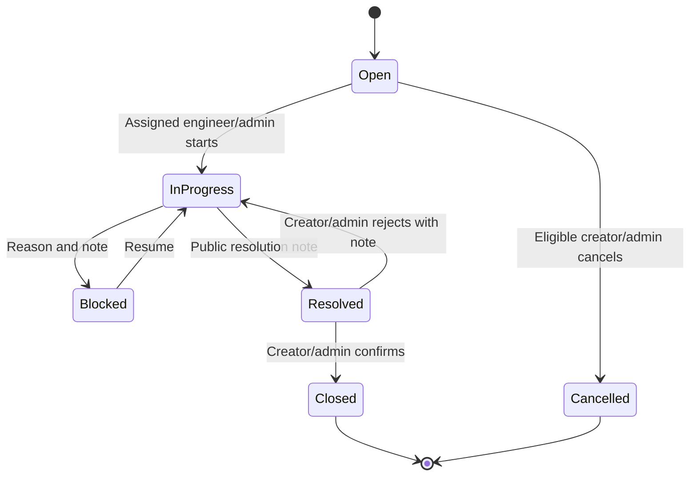
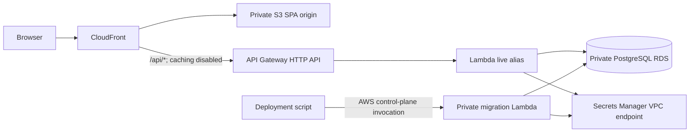

# ACME Facility Incident Management Platform — Project Requirements Document

October 20, 2026 · Roger · Version 1.1 (revised draft)

## 1. Document control and purpose

This document specifies the workshop release of ACME's stand-alone facility incident management application. It defines scope, behavior, implementation boundaries and acceptance. Version 1.1 supersedes version 1.0 for implementation planning; the original remains available as a historical reference.

| Item | Value |
| --- | --- |
| Audience | Product, frontend, backend, infrastructure and QA |
| Source | Workshop guidance and the October 20, 2026 PRD, revised following scope and consistency review |
| Delivery deadline | Thursday, October 22, 2026, 5:00 PM America/New_York |
| Release gate | All Core MVP acceptance criteria pass on the deployed AWS application |

### Reading and priority rules

- **Core MVP** is mandatory for the workshop. **Enhancement** is deferred until Core MVP is deployed and accepted. Bonus work follows enhancements.
- Requirement IDs from v1.0 remain stable. A deferred requirement retains its ID. New requirements receive new IDs.
- Sections 4 and 12 define release scope and acceptance. A deferred API, field, widget or dependency is not a Core MVP delivery obligation.
- “Non-final” means Open, In Progress, Blocked or Resolved. Closed and Cancelled are final.
- “Creator” means the user identified by `created_by`. A follower is a separate relationship and never implies ownership.
- CRUD uses logical deletion: cancellation for incidents, deactivation for reference records and engineer profiles, and audited hiding for notes. No business record is physically deleted through the application.

### Revision summary

1. Separate the mandatory reporting-to-closure workflow from attachments, duplicate following, Kanban, advanced analytics and scheduled automation.
2. Separate creator and follower permissions; define multi-role access and final-state behavior.
3. Define note editing, hiding, visibility and audit behavior.
4. Define escalation at Critical priority, pending-request exclusivity and terminal-state boundaries.
5. Add persistent refresh sessions and login-lockout state.
6. Specify private-network database migration, administrator initialization and release activation.

## 2. Executive summary

ACME employees currently report workplace problems through disconnected emails, chats and manual trackers. The platform provides one place to report an issue, assign an engineer, communicate, resolve it and confirm closure.

The Core MVP delivers the complete flow: **register/login → report → triage and assign → work or block → resolve → creator confirms or rejects**. Administrators maintain facilities, categories and engineers. Each persona has a basic dashboard. Search, audit events, server-side authorization and responsive layouts are mandatory.

The stack is React with TypeScript, MUI and react-responsive; Python FastAPI; and PostgreSQL. AWS deployment uses S3, CloudFront, API Gateway, Lambda and private RDS, provisioned through Terraform and deployed with a shell script. There are no external business-system integrations.

## 3. Business outcomes

| Question | Core MVP answer | Deferred enhancement |
| --- | --- | --- |
| Q1: What is open and in which status? | Filtered incident list, status counts and ticket stepper | Kanban board |
| Q2: Where do issues recur? | Location counts and recurring location/category table | Interactive heatmap |
| Q3: How fast are issues handled? | Created, first assigned, acknowledged and resolved timestamps; mean durations | Median, SLA timers and compliance reports |
| Q4: Who is available and how is work distributed? | Engineer availability and non-final assigned counts by status | Skill/building assignment ranking |
| Q5: Which categories are common? | Category counts | Interactive subcategory drill-down |
| Q6: What is escalated or blocked, and why? | Pending escalation list and blocked-reason list | Reason trends and automated alerts |
| Q7: Are employees informed? | Public timeline, recent public updates and last-public-update timestamp | Notification bell and communication-health percentages |

Counts must come from persisted application data. Dashboards must not display fabricated metrics. Core communication is through the ticket and dashboard; push or bell notifications are not required for Core MVP.

## 4. Release scope

### Core MVP — mandatory

- Authentication, persistent sessions, account lockout and additive server-side RBAC.
- Building → Floor → Seat maintenance, two-level categories and seed data.
- Engineer creation, editing, deactivation/reactivation, availability and workload.
- Incident creation, authorized list/detail/edit and cancellation.
- Public/internal notes, author editing and administrator hiding.
- Assignment/reassignment, priority and basic escalation request/decision.
- Open, In Progress, Blocked, Resolved, Closed and Cancelled workflow; audit timeline and visual stepper.
- Basic persona dashboards answering Q1–Q7 using the definitions in section 6.
- Search, filters, URL persistence and pagination.
- Responsive and keyboard-accessible core flows.
- Automated checks, demo seed data, repeatable AWS deployment and database health check.

### Enhancements — not required to pass the workshop release

| Area | Deferred requirements |
| --- | --- |
| Convenience | FR-3.2 bulk seats; FR-5.2 default seat |
| Duplicate reduction | FR-5.3 suggestions/following; FR-7.5 duplicate closure |
| Files | Image parts of FR-5.1/FR-6.1; FR-6.4 attachment upload/download; mobile camera capture |
| Assignment assistance | Skill and home-building match ranking in FR-7.2 |
| Board | FR-8.2–FR-8.5 Kanban, drag/drop and mobile board |
| SLA | Due times, at-risk/breach classification, SLA filters and widgets |
| Notifications | FR-10.1–FR-10.3 bell, polling and notifications |
| Automation | FR-12.1 SLA job and 72-hour auto-close |
| Advanced reporting | Medians, SLA compliance, communication ratios, drill-down and CSV export |

### Excluded from the workshop release

Email/SMS/chat integrations, SSO/Cognito, email verification, asset/HR/calendar integrations, configurable business-hour SLAs, localization, native mobile apps, offline support and load testing beyond demo scale.

Bonus ideas: seat QR codes, floor-plan heatmaps, AI suggestions and CSAT. Start only after accepted Core MVP and selected enhancements.

## 5. Personas and authorization

Every user has Employee permissions. Engineer and Admin are additive roles; one user may hold both. Staff retain creator permissions on incidents they report. Authorization is evaluated per incident and action, not by a client-selected persona tab. Having the Engineer role alone does not permit reading internal notes on a ticket assigned to someone else.

| Action | Creator (Employee permission) | Follower (enhancement) | Assigned engineer | Admin |
| --- | --- | --- | --- | --- |
| Create incident | Yes | As any employee | As any employee | Yes |
| Read ticket/public timeline | Own tickets | Followed ticket public projection | Assigned tickets | All |
| Edit title, description, category, location | While Open | No | Assigned, non-final | Non-final |
| Set requested priority | Creation only | No | Only when creating own ticket | Only when creating own ticket |
| Set actual priority | No | No | No | Non-final |
| Request escalation | Non-final | No | Only as creator | As creator |
| Decide escalation | No | No | No | Pending, non-final |
| Assign/reassign/unassign | No | No | No | Non-final, subject to section 7 |
| Cancel | Open and unassigned, reason required | No | Only as eligible creator | Open, reason required |
| Start/block/resume/resolve | No | No | Valid assigned transitions | Valid transitions |
| Confirm/reject resolution | Yes | No | Only as creator | Yes |
| Add public note | Non-final | No | Assigned, non-final | Non-final |
| Read/add internal note | No | No | Assigned; add only non-final | All; add only non-final |
| Edit note | Own note under FR-6.3 | No | Own note under FR-6.3 | Own note under FR-6.3 |
| Hide note | No | No | No | Yes, including final tickets |
| Upload image (enhancement) | Non-final | No | Assigned, non-final | Non-final |
| Manage facilities/categories/users/engineers | No | No | No | Yes |
| Set availability | No | No | Own profile | Any engineer |
| Dashboard | Own tickets | Public followed updates only | Own assigned queue | Organization |

Follower access is restricted to number, title, status, actual priority, location, category, public workflow events and visible public notes. It excludes description, creator contact details, internal notes and restricted attachments. It grants no editing, cancellation, confirmation or escalation rights. Suggestions expose only the smaller preview specified in FR-5.3. Any employee, including staff, may follow an eligible suggestion when the enhancement is enabled.

Users without read access receive 404. A user with read access but without permission for an action receives 403. An authorized but invalid state operation receives 409. Apply this ordering consistently to prevent incident enumeration.

## 6. Functional requirements

Requirements are Core MVP unless explicitly deferred in section 4.

### FR-1 Authentication

- FR-1.1 Register with full name, email matching `^[^@\s]+@acme\.inc$` case-insensitively, and password. Normalize email to lowercase; unique constraint enforced in PostgreSQL. Invalid domain returns 422; duplicate returns 409.
- FR-1.2 Passwords require at least 10 characters, one letter and one digit; bcrypt cost 12. Reject passwords exceeding 72 UTF-8 bytes rather than silently truncating.
- FR-1.3 Login returns a 15-minute JWT access token in the response and an opaque 7-day refresh token in an httpOnly, Secure, SameSite=Strict cookie. Keep access tokens in browser memory. Rotate refresh tokens transactionally; store only their hashes. Logout revokes the current refresh-session family and clears the cookie. Reuse of a rotated token revokes its family. Enforce same-origin checks on cookie-authenticated mutations.
- FR-1.4 Five failed password checks within a rolling 15-minute window set `locked_until` to 15 minutes after the fifth failure. The sixth attempt, even with a correct password, is rejected until expiry. Successful login resets failures. Lockout state is shared in PostgreSQL, not Lambda memory; concurrent attempts update it atomically. Unknown emails receive generic authentication errors.
- FR-1.5 Seed the first admin at deployment from `SEED_ADMIN_EMAIL` and `SEED_ADMIN_PASSWORD` using the controlled process in section 10.
- FR-1.6 Admin-created engineers receive a temporary password displayed once to the creating admin. Until changed, only password change, current-user inspection and logout are permitted. No external delivery is required.
- FR-1.7 Password change or user deactivation revokes all refresh sessions and invalidates existing access tokens using the user's token version. Role changes take effect on the next request by checking current database roles. Never log tokens or passwords.

### FR-2 Authorization

- FR-2.1 Enforce section 5 in every endpoint, list query, count, dashboard and response serializer.
- FR-2.2 Creator access and assigned-engineer access are a union; admins see all. Following adds only the public projection when enabled.
- FR-2.3 Internal note bodies, attachments and revealing audit metadata are never included for a reader without incident-specific staff access. Hidden note content is never returned through ordinary ticket, search or timeline responses.
- FR-2.4 Unauthorized incident reads return 404; nested resources apply the parent incident's visibility rules.
- FR-2.5 Navigation has My tickets, My queue and Admin sections according to roles; dashboards use role tabs without changing server permissions.
- FR-2.6 A creator who is also the assignee may explicitly close their own Resolved ticket. Resolution still requires an In Progress → Resolved event and public note; no automatic Resolved → Closed jump occurs.

### FR-3 Facilities and categories

- FR-3.1 Admins create/read/update/deactivate/reactivate buildings, floors and seats in an expandable hierarchy. Enforce building code/name uniqueness, floor level uniqueness per building and seat code uniqueness per floor.
- FR-3.2 Enhancement: bulk-create seats using prefix, range and zero padding; reject collisions atomically.
- FR-3.3 Use deactivation rather than hard deletion. A building, floor or seat with any non-final incident in its subtree cannot be deactivated; return 409 with the affected count. Deactivation hides descendants from new incident selection without rewriting history. New selections require active ancestors. Reactivation does not automatically reactivate independently inactive descendants.
- FR-3.4 Admins maintain a maximum two-level category tree. Deactivation preserves historical references and removes the subtree from new selection. Existing tickets retain their category. New tickets select a child, or a parent with no active children. No third level is allowed.

### FR-4 Engineer management

- FR-4.1 Admins create engineers with name, @acme.inc email and optional phone; adding Engineer to an existing account creates its profile. Skills and home buildings are optional enhancement fields.
- FR-4.2 Admins edit/deactivate/reactivate profiles. Deactivation or Engineer-role removal requires zero non-final assigned tickets. Reassign In Progress/Blocked/Resolved work to another active engineer; only Open tickets may be unassigned. Do not deactivate the user account merely to deactivate the engineer profile.
- FR-4.3 Engineers set Available, Busy or Off-duty; admins may also set it. Availability does not replace profile active status.
- FR-4.4 List availability, non-final workload and status counts. Staff workload counts do not grant employees access to others' incidents.

### FR-5 Incident reporting

- FR-5.1 Form: title 5–120 characters; description 10–5,000; category; building; dependent floor; optional dependent seat; requested priority default Medium with explanations. Validate the hierarchy on the server. Images are deferred.
- FR-5.2 Enhancement: prefill a valid active default seat and its ancestors.
- FR-5.3 Enhancement: after category/floor selection, show up to five non-final incidents from the last seven days on the same floor and top-level category. Preview only number, title, status, location and age. Following may be chosen instead of creation and grants only section 5's public projection. Unfollowing removes follower-only access.
- FR-5.4 Submission allocates a unique INC-000123-style number and opens detail. Numbers use a database sequence; gaps are allowed.

### FR-6 Detail, notes and attachments

- FR-6.1 Detail shows number, title, status, priority, assignee, fields, workflow stepper and ordered public/staff timeline. SLA timers and attachments are enhancements.
- FR-6.2 Staff choose Public by default or Internal. Show internal notes with a label and lock icon. Employees cannot select Internal. Render plain text safely; links must not execute script.
- FR-6.3 Notes contain 1–5,000 characters. Only the author may edit within 10 minutes of creation, while the incident is non-final and the author retains permission to add that visibility of note. Visibility and authorship cannot be changed. Note edits record actor/time and an audit event. No role may edit another user's note.
- FR-6.4 Enhancement: up to five JPEG/PNG/WebP/HEIC images per incident, maximum 5 MB each, private S3 uploads/downloads. Upload intent alone grants no read access: verify actual file signatures and size server-side before marking an object accepted. Enforce note visibility and incident access on downloads; presigned GET expires after five minutes.
- FR-6.5 Admin-only `POST /notes/{id}/hide` requires a reason, sets `hidden_at`, `hidden_by` and `hide_reason`, and is idempotent. Return a tombstone without body or attachment links to otherwise authorized readers. Keep the original body in storage for audit, with no ordinary API to retrieve it. Add a sanitized `note_hidden` event; do not copy hidden content into events or notifications. Unhide and hard delete are outside scope.
- FR-6.6 Cancellation and note hiding are the user-facing logical-delete operations required by CRUD. UI labels must state Cancel incident and Hide note; final incidents otherwise remain read-only. Hiding an existing resolution note does not undo its transition.

### FR-7 Triage, priority and escalation

- FR-7.1 Triage lists unassigned Open tickets by Critical → Low priority, then oldest first.
- FR-7.2 Assign only active engineers; show availability and workload. Warn but allow Off-duty assignment. Skill/building ranking is deferred.
- FR-7.3 Reassignment and unassignment require a reason. Keep first `assigned_at` unchanged; events record later assignments. Core MVP exposes changes in timelines and queues; notifying old/new assignees is deferred to FR-10.
- FR-7.4 Apply section 7's priority/escalation rules transactionally.
- FR-7.5 Enhancement: admins may close a non-final incident as a duplicate of an existing non-duplicate, non-cancelled ticket. Reject self-links and cycles; creator becomes a follower of the target. Closing records reason and target and supersedes a pending escalation.

### FR-8 Workflow visualization

- FR-8.1 Core: stepper Open → In Progress → Resolved → Closed; show Blocked as a side state and Cancelled as terminal. Display actual transition timestamps and actors; reopen history remains in timeline. All actions use the transition API.
- FR-8.2–FR-8.5 Enhancement: staff Kanban with Open/In Progress/Blocked/Resolved columns, optional final statuses, valid-transition drag/drop and required-input dialogs; cards show priority, SLA when enabled, assignee and location. Mobile uses status tabs and Move to actions instead of dragging.

### FR-9 Search and filtering

- FR-9.1 Search authorized tickets by exact incident number and title/description using PostgreSQL full-text search. Never expand visibility through search.
- FR-9.2 Core filters: status, priority, category, building, floor, assignee, escalation and date range; creator filter is admin-only. SLA-state filter is deferred.
- FR-9.3 Sort by created, updated or priority; stable tie-break by ID; 25 records per page, maximum 100. SLA due sorting is deferred.
- FR-9.4 Persist filters, sort and page in URL. Reject unsupported fields and values. Do not put note bodies, descriptions or contact details in URLs.
- FR-9.5 Admin users, engineers and facilities lists support basic text search.

### FR-10 Notifications — enhancement

- FR-10.1 Bell with unread count and 30-second polling.
- FR-10.2 Notify for status, assignment/reassignment, public notes, escalation decisions, SLA thresholds and auto-close. Public recipients are creator and followers; assignee receives permitted staff updates. Exclude the actor and recheck recipient access. Internal/hidden note bodies are never copied into notifications.
- FR-10.3 Open ticket and mark read; support mark-all-read. An inaccessible ticket still returns 404 after reassignment/unfollow/deactivation.

### FR-11 Basic dashboards and reports

Compute live SQL within caller permissions. Admin default cohort is incidents created in the last 30 days, with building filter. Date bounds are UTC instants using an inclusive start and exclusive end. Each count links to an equivalent authorized list; aggregate duration tables link to the underlying cohort. Support a table view for any chart.

| Persona/widget | Core definition |
| --- | --- |
| Employee status/recent updates | Creator's tickets by status; latest visible public notes/events; followed updates only when enabled |
| Awaiting confirmation | Creator's Resolved tickets; no auto-close countdown in Core |
| Engineer queue | Assigned non-final counts by status, oldest first, availability control |
| Engineer completed work | Count and mean created→resolved duration for currently Resolved/Closed tickets with `resolved_at` in the current local calendar week, assigned to that engineer at the latest resolution event |
| Admin status/priority | Non-final counts by status and priority |
| Admin workload | Current non-final counts per assignee by status; unassigned shown separately; active engineer availability list/counts |
| Admin lifecycle speed | Mean created→first acknowledged, →first assigned, →latest resolved durations for cohort tickets with each timestamp; show sample count separately and exclude missing timestamps |
| Location hotspots | Top ten buildings, floors and seats separately by cohort count; recurring flag for at least three tickets at the same exact location and category in the trailing 30 days. Exact location uses seat if present, otherwise floor. Do not double count one ticket within a ranking |
| Category counts | Cohort counts by top-level category, aggregating descendants |
| Escalated/blocked | Current pending escalations with reason; Blocked tickets with reason, current blocked-since timestamp and assignee, within cohort |
| Communication | Last visible public-note timestamp per non-final ticket and recent public updates; show No public note where absent |

Enhancements: SLA health/compliance, medians, interactive drill-down, notification activity, public-update percentage, notes-per-resolution, reopen-rate and CSV. Specify denominators and test fixtures before implementing these additional metrics.

### FR-12 Scheduled jobs — enhancement

- FR-12.1 EventBridge invokes a private job Lambda every 15 minutes. Close eligible Resolved tickets at or after `resolved_at + 72 hours`, checking current status/version inside the transaction. Send SLA threshold notifications once per ticket, threshold and SLA revision using a database uniqueness key. Retries must not duplicate closure events or notifications. No public HTTP job endpoint.
- Core MVP requires manual creator/admin closure only; no silent auto-close behavior.

### FR-13 Responsive design and accessibility

- FR-13.1 MUI breakpoints xs <600 px and md ≥900 px; use react-responsive for layout switches.
- FR-13.2 Core flows work at 375 px and desktop: mobile card lists, suitable navigation and full-screen dialogs. Camera capture is deferred with attachments.
- FR-13.3 Target WCAG 2.1 AA: labeled inputs, keyboard navigation, visible focus, text status labels and 4.5:1 normal-text contrast. Charts have equivalent tables.

## 7. Workflow and edge cases

Every authorized transition not listed below returns 409. Every accepted mutation writes an audit event in the same transaction. Notifications apply only when the enhancement is enabled.

| From → To/action | Who | Required behavior |
| --- | --- | --- |
| New → Open | Any authenticated user | Set creator, number, requested/actual priority and creation event |
| Assign/reassign | Admin | Any non-final state; active engineer; first assignment sets `assigned_at`; reassignment requires reason |
| Unassign | Admin | Open only; reason required |
| Open → In Progress | Assigned engineer/admin | Assignee required; set first-in-progress and first acknowledgment if absent |
| Open → Cancelled | Creator/admin | Reason required; creator only while unassigned; set cancellation timestamp |
| In Progress → Blocked | Assigned engineer/admin | Reason code and public or internal note required; set `blocked_since` |
| Blocked → In Progress | Assigned engineer/admin | Clear current reason/since; retain blocked interval in audit |
| In Progress → Resolved | Assigned engineer/admin | Non-empty public resolution note; set `resolved_at`; resolution event captures assignee |
| Resolved → Closed | Creator/admin | Explicit confirmation; set `closed_at`; system allowed only after FR-12 is enabled |
| Resolved → In Progress | Creator/admin | Public rejection note required; clear current `resolved_at`; preserve prior resolution events and increment reopen count |
| Non-final → Closed as duplicate | Admin; enhancement | Follow FR-7.5 |

Blocked reason codes: Waiting on parts, Waiting on employee, Vendor needed, Access needed, Other. Notes are always required when blocking. Acknowledgment is the first In Progress transition or first public note from the currently assigned engineer. An admin public note acknowledges only when that admin is also the assigned engineer.

### Priority and escalation

1. Requested priority is immutable after creation; actual priority starts equal to it. Only an admin changes actual priority on a non-final ticket, recording a reason and audit event.
2. Only the creator may request escalation, including a creator who also has a staff role. Reason length is 10–500 characters.
3. Allow at most one pending request per ticket. A second pending request returns 409 regardless of elapsed time. After a decision, a new request is allowed only at least 24 hours after the previous request's creation. Store request time and decision separately.
4. Admin approval below Critical must raise actual priority by at least one level. At Critical, approval keeps Critical but requires a public action-plan note explaining the response or reassignment; the API rejects a missing plan. Show that this is an action escalation, not a higher priority.
5. Rejection requires a public reason. Decision, optional reassignment, priority update and public note commit atomically. Only pending requests may be decided; repeat/stale decisions return 409.
6. Closure or cancellation supersedes a pending request in the same transaction and logs the reason. Do not fabricate an administrator approval/rejection. Add `Superseded` to escalation state.
7. Final tickets reject detail edits, notes/attachments, assignment, priority, escalation and workflow mutations with 409 for otherwise authorized callers. Admin note hiding remains allowed. Reads and personal follow/unfollow when enabled remain available.

### SLA policy — enhancement only

| Priority | Acknowledge | Resolve |
| --- | --- | --- |
| Critical / P1 | 1 hour | 4 hours |
| High / P2 | 4 hours | 24 hours |
| Medium / P3 | 24 hours | 72 hours |
| Low / P4 | 48 hours | 120 hours |

Calendar hours from creation; at risk at 75%, breached at due time. Blocked does not pause time. Priority changes recalculate from original creation, increment SLA revision and may cause immediate breach. Evaluate acknowledgment only until acknowledged; resolution until resolved/final. Reopening uses the current priority and original creation time, never grants a fresh SLA window. Core timestamps are retained so SLA can be added later.

## 8. Data model

Core MVP uses **11 logical tables**. Additional association tables may normalize skills/roles; physical table count is not an acceptance criterion. Use UUID IDs, UTC timestamps and foreign keys; append-only event records need creation time rather than mutable update time.

| Core entity | Key fields and constraints |
| --- | --- |
| `users` | Unique lowercase email, full name, password hash, additive roles, is_active, must_change_password, token_version, failed_login_at timestamps limited to the current window, locked_until; lockout updates use row locking |
| `refresh_sessions` | user_id, unique token_hash, family_id, expires_at, revoked_at, rotated_at, replaced_by_id; never store raw tokens; index family/user/expiry; remove expired sessions after a defined seven-day audit grace period |
| `engineer_profiles` | Unique user_id, phone, is_active, availability; optional future skill/home-building associations |
| `buildings` | Unique name/code, address, is_active |
| `floors` | building_id, name, level_number, is_active; unique building/level |
| `seats` | floor_id, code, is_active; unique floor/code |
| `categories` | name, parent_id, sort_order, is_active; maximum depth two |
| `incidents` | Unique number, creator, title/description, category/location FKs, status, requested/actual priority, assignee, blocked_reason/since, created/updated/first assigned/acknowledged/first in-progress/resolved/closed/cancelled timestamps, reopen_count; hierarchy checked transactionally |
| `incident_notes` | incident_id, author_id, body, visibility, edited_at, hidden_at/by/reason; visibility immutable |
| `incident_events` | incident_id, actor_id or system actor, type, safe payload, timestamp; append-only; retain note edit history with the same visibility restrictions as the original note |
| `escalation_requests` | incident_id, requester_id, reason, requested_at, state, decided_by/at, decision_reason/action_plan; unique partial index permits one pending request per incident |

Enhancement tables: `attachments`, `incident_followers` (unique incident/user), `notifications` and `job_deliveries` (unique incident/threshold/SLA revision). Add default seat, duplicate link and SLA fields through later migrations. Latest escalation state is derived from the latest request, not maintained as an independent conflicting source.

Event types: created, details_changed, status_changed, assigned, unassigned, priority_changed, escalation_requested/approved/rejected/superseded, note_added/edited/hidden; duplicate_marked and auto_closed when enabled. Do not embed internal note bodies in public event payloads.

Index incidents by status, creator, assignee, location, category and creation/update times; use a GIN full-text index. Store note visibility in access-controlled queries, not client filtering. Retain business records; expired authentication records may be purged under their separate retention policy.

### Seed categories

| Category | Subcategories |
| --- | --- |
| IT and AV equipment | Display/monitor, Conference room AV, Cables and adapters, Docking station, Printer/scanner, Laptop/peripheral |
| Network and Wi-Fi | No connectivity, Slow connection, Wired port dead |
| Furniture | Desk/chair broken, Ergonomic request |
| HVAC and temperature | Too hot, Too cold, Air quality |
| Electrical and lighting | Light out, Power outlet, Flickering |
| Plumbing and restrooms | Leak, Clog, Supplies |
| Cleaning | Spill, Trash, General cleaning |
| Access and security | Badge reader, Door/lock, Lost and found |
| Other | None |

## 9. Non-functional requirements

| ID | Requirement |
| --- | --- |
| NFR-1 Security | HTTPS in deployed environment; Secrets Manager for JWT/database credentials; Pydantic validation; parameterized SQL/ORM; persistent lockout; private RDS. Attachment signature checks apply when enabled. Local development may relax Secure cookie only via explicit development configuration |
| NFR-2 Privacy | Incident-specific permissions apply to all projections, aggregates, events and files. No tokens, passwords, note bodies or descriptions in logs; use user/request IDs |
| NFR-3 Audit | State, assignment, priority, escalation, note edit/hide and detail changes record actor/time atomically; no business hard-delete APIs |
| NFR-4 Concurrency | Incident detail/workflow/assignment/priority/escalation changes require `If-Match` equal to the returned `updated_at`; missing returns 428, stale returns 409. Compare and update atomically. Note edits/hiding use the note's own version; parent final-state checks share the mutation transaction |
| NFR-5 Scale | About 20 users and 500 tickets; inspect normal demo page responsiveness; no load-test gate |
| NFR-6 Reliability | Public `/health` (also exposed as `/api/health`) checks a lightweight DB query; 200 healthy, 503 unavailable, no secrets. RDS daily backup with seven-day retention |
| NFR-7 Compatibility | Latest two major versions of Chrome, Edge, Safari and Firefox; mobile Safari/Chrome; width ≥375 px |
| NFR-8 Accessibility | FR-13.3; verify the complete reporting flow with keyboard and mobile layouts |
| NFR-9 Observability | Structured request-ID JSON logs in CloudWatch; sanitized failures |
| NFR-10 Time | UTC storage; browser-local display; explicit timezone and UTC bounds for reporting |
| NFR-11 Quality | pytest ≥70% coverage of workflow/permissions; every Core endpoint tested for anonymous, employee, engineer, admin and combined roles, including creator/other/assigned relationships. Vitest for auth handling, reporting form and workflow actions; ruff and ESLint |

## 10. Architecture and delivery

The frontend and API share a public origin. CloudFront forwards authorization, cookies, query strings and required methods for `/api/*`; API responses are not cached. SPA fallback must not rewrite API errors to HTML. Lambda is configured for VPC access; RDS has no public access.

### Stack and dependencies

| Layer | Core choice |
| --- | --- |
| Frontend | React 18, TypeScript, Vite, MUI v6, react-responsive, React Router, TanStack Query, React Hook Form + Zod |
| Backend | Python 3.12, FastAPI, Pydantic v2, SQLAlchemy 2, Alembic, Mangum, bcrypt, PyJWT |
| Database | PostgreSQL 16, RDS db.t4g.micro, single AZ |
| Infrastructure | Terraform ≥1.6; VPC/subnets/security groups, S3/CloudFront OAC, API Gateway, Lambda/alias, RDS, Secrets Manager endpoint, CloudWatch |
| Local | Docker Compose for PostgreSQL/API; Vite; Node ≥20; lock dependencies |
| Delivery | GitHub repository, AWS CLI and Bash `scripts/deploy.sh` (WSL/Git Bash on Windows) |
| Deferred | MUI X Charts if needed, dnd-kit, private attachment bucket/S3 endpoint, EventBridge and job Lambda |

### Network and deployment decisions

1. RDS uses a private DB subnet group across two availability zones, with a single-AZ instance. DB ingress on port 5432 is restricted to API/migration Lambda security groups; no workstation IP access.
2. API and migration Lambdas reach Secrets Manager through an interface VPC endpoint with private DNS and HTTPS access from their security groups. Use managed runtime log delivery; no runtime external business calls. Core does not require NAT. Add an S3 gateway endpoint for Lambda-side attachment validation only when attachments are enabled.
3. Package dependencies on the build machine using a Linux/Python-compatible build environment, never by downloading packages inside a private Lambda. The migration function runs the packaged Alembic code in the same VPC as RDS. It has no API Gateway route.
4. The deployment identity invokes migration through the AWS Lambda control-plane API, then checks both the invocation result and migration output. This avoids a direct workstation-to-RDS connection. Serialize deploys and use a PostgreSQL advisory lock for migrations.
5. Store secrets in Secrets Manager through a controlled bootstrap step; Terraform references secret ARNs and does not place plaintext values in code, outputs or committed variables. Secure remote Terraform state using encryption and locking.
6. The migration/seed function reads the seed administrator secret. Validate domain/password, hash with cost 12, and create the admin only if no admin exists. If the email already belongs to a non-admin, fail explicitly rather than silently elevating it. On later deploys, never reset an existing admin password or restore deliberately removed roles. Do not expose seed credentials in command arguments or logs. Remove the bootstrap secret after initial success; subsequent runs skip bootstrap when an admin exists. Zero-admin recovery is an explicit operator procedure. Prevent removing/deactivating the last active admin through normal APIs.

### `scripts/deploy.sh` release sequence

1. Validate tools, AWS identity/region, configuration and secret references. Run lint/tests and build the SPA and compatible Lambda artifacts.
2. Apply infrastructure without changing the existing API `live` alias. On first deployment use a maintenance/health-only bootstrap function until initialization succeeds.
3. Update and synchronously invoke the private migration function; apply forward-compatible migrations, seed reference data idempotently, and bootstrap the first admin. Demo users/tickets are opt-in for workshop environments only; never overwrite live records.
4. Publish a candidate API version and invoke its DB health check. Abort on any migration, invocation or health failure. Existing traffic stays on the prior version; migrations must remain backward compatible with it.
5. Point `live` to the tested version. Upload content-hashed SPA assets before `index.html`, set index to no-cache and invalidate CloudFront. API changes must support both old and new SPA during propagation.
6. Run public `/api/health` and authenticated smoke checks. On failure restore the prior alias and frontend release; do not automatically reverse destructive schema changes. Store release IDs and a manual recovery procedure.

Scheduled jobs, when implemented, use EventBridge's dedicated invoke permission and a restricted job execution role; no browser token or public endpoint. Their private DB/secrets connectivity follows the same network design.

### API outline

JSON under `/api/v1`; health also at `/health` and CloudFront `/api/health`. Errors use `{"error":{"code":"...","message":"...","details":{}}}`. Lists return `{items,total,page,page_size}`. FastAPI generates OpenAPI. Validate endpoint permissions independently of navigation.

| Area | Core endpoints |
| --- | --- |
| Auth | POST `/auth/register`, `/auth/login`, `/auth/refresh`, `/auth/logout`, `/auth/change-password`; GET `/auth/me` |
| Users | GET `/users`; PATCH `/users/{id}` for admin roles/active state; PATCH `/users/me` for allowed self fields only |
| Engineers | GET/POST `/engineers`; GET/PATCH `/engineers/{id}`; PATCH `/engineers/me/availability` |
| Facilities | GET/POST `/buildings`, `/buildings/{id}/floors`, `/floors/{id}/seats`; PATCH `/buildings/{id}`, `/floors/{id}`, `/seats/{id}`; GET `/locations/tree` |
| Categories | GET/POST `/categories`; PATCH `/categories/{id}` |
| Incidents | GET/POST `/incidents`; GET/PATCH `/incidents/{id}` |
| Workflow | POST `/incidents/{id}/transitions`, `/assign` (nullable assignee for permitted unassignment), `/escalation`, `/escalation/decision`; PATCH `/incidents/{id}/priority` |
| Notes | GET/POST `/incidents/{id}/notes`; PATCH `/notes/{id}`; POST `/notes/{id}/hide` |
| Timeline | GET `/incidents/{id}/timeline` |
| Dashboards | GET `/dashboard/employee`, `/dashboard/engineer`, `/dashboard/admin` with supported date/building filters |
| Health | GET `/health`; GET `/api/health` through CloudFront |

Enhancement APIs: bulk seats; similar incidents/follow/unfollow; duplicate marking; attachment presign/finalize/download; notifications/read/read-all. They are disabled or absent until implemented and tested. Staff APIs use section 5's matrix; health/register/login/refresh have their explicitly defined public/session behavior.

## 11. Assumptions, dependencies and risks

One participant builds a demo using synthetic data and an authorized AWS account. Any @acme.inc address is assumed eligible; no email verification. One assignee per incident. AWS infrastructure is permitted; external business integrations are excluded.

Required inputs before deployment: AWS account/region and permissions for the listed services, a GitHub repository, secure seed administrator credentials and a Terraform state location. These are deployment dependencies, not assumed to be configured merely because this PRD exists. Toolchain: Docker, Node, Python/build container, Terraform, AWS CLI and Bash.

| Risk | Mitigation |
| --- | --- |
| Limited workshop time | Deploy skeleton first; deliver only Core MVP before considering enhancements |
| Private DB migration/connectivity failure | Prove migration Lambda, Secrets Manager endpoint and public DB health path on day 1 |
| Permission leakage | Central incident authorization; role × endpoint × ownership tests, including note/event projections |
| Session state lost across Lambda invocations | PostgreSQL refresh/lockout persistence and concurrency tests |
| Failed release after migration | Additive compatible migrations, candidate smoke test and alias rollback |
| Stale frontend | Hashed assets, index no-cache, release retention and CloudFront invalidation |

## 12. Acceptance and build order

### Mandatory Core MVP acceptance

| Area | Pass criteria |
| --- | --- |
| Authentication | Invalid domain 422; duplicate 409; expired token refreshes once then returns to login if refresh fails; fifth failure sets lock, sixth is blocked; expiry unlocks; logout/reuse/password change/session revocation tested across separate backend instances |
| RBAC | Core role/endpoint matrix passes, including combined roles and engineer-as-creator; unauthorized reads 404; unauthorized actions on readable tickets 403; employee projections contain no internal note content or revealing events |
| Facilities/categories | Hierarchy and uniqueness validation pass; CRUD is exercised through create/read/update/deactivate/reactivate; non-final incidents block location-subtree deactivation; categories remain visible on historical tickets |
| Engineers | Create/edit/deactivate/reactivate works; temporary password is restricted; non-final assignments block deactivation; availability updates appear after refresh; last active admin cannot be removed |
| Reporting | At 375 px a prepared user submits a valid incident in under 60 seconds; server rejects mismatched floor/seat; incident number/detail returned; creator edits only while Open |
| Notes | Creator sees exactly three public notes when staff sees three public and two internal; author-only ten-minute edit boundary tested; hidden content/links absent for every ordinary response; hide reason/event retained; final ticket rejects new/edit notes |
| Assignment/escalation | Active assignee required; reassignment reason mandatory; one pending request enforced atomically; cooldown tested; approval raises priority below Critical; Critical approval requires public action plan; rejection requires reason; finalization supersedes pending request |
| Workflow | Every allowed transition succeeds for authorized relationships; invalid transitions return 409; resolution/rejection/blocking require their notes; creator confirms or rejects; self-assigned creator still records separate resolution and closure; final-state restrictions hold |
| Concurrency | Missing incident If-Match 428; stale 409; concurrent assignment/transition/escalation cannot overwrite each other; note edits enforce their own version |
| Visualization | Stepper and event history match persisted status, timestamps and actors, including blocking and reopening; keyboard actions use the same API |
| Search | Exact incident number works; combined filters return correct authorized results; pagination/sort deterministic; reload restores URL filters |
| Dashboards | Core widgets answer Q1–Q7 and match fixture SQL counts/means; missing timestamps excluded with sample sizes; widget links reproduce the filtered cohort |
| Responsive/accessibility | Core flows at 375 px and 1440 px without horizontal scrolling; keyboard-only report/assignment/resolve flows; labels, focus and contrast checked |
| Deployment | Public CloudFront HTTPS application; health returns 200 with DB available and 503 without; migration succeeds without public RDS; idempotent seed/redeploy preserves users; failed candidate leaves previous API active |

### Enhancement acceptance — applies only when enabled

- Following grants public read-only access; cannot edit, cancel, escalate or confirm; unfollow removes follower-only access. Duplicate previews never expose description, identity or notes.
- A 6 MB image or renamed PDF is rejected after upload validation; employee cannot retrieve an internal-note attachment.
- Kanban accepts/rejects the same transitions as the API; required-input dialogs and mobile Move to work.
- Notifications reach eligible recipients, exclude actor, deduplicate retries and update unread count within 30 seconds.
- Job closes a ticket at or after 72 hours on its next scheduled run (normally within 15 minutes); does not close a concurrently reopened ticket. Repeated invocation creates one closure event. SLA notifications occur once per threshold/revision.
- Bulk seats creates 40 distinct seats and handles duplicates atomically. Deferred metrics gain explicit definitions and fixture-based checks before release.

### Demo success checklist

- [ ] Public CloudFront HTTPS URL and healthy private database connection.
- [ ] Employee reports and tracks; admin maintains facilities/engineers and assigns; engineer communicates, blocks/resumes and resolves; employee confirms/rejects.
- [ ] All Core MVP criteria pass, with evidence recorded.
- [ ] Admin basic reports answer Q1–Q7 from seed data.
- [ ] One deploy script completes a clean redeploy without manual DB access or credential disclosure.
- [ ] Deferred features are not presented as completed.

### Build order and time boxes

1. **Day 1 / first session:** repository, Compose, API/SPA shells, Terraform, migration Lambda, deployment script and public health check. Resolve deployment blockers immediately.
2. **By Wednesday, October 21 evening:** auth/RBAC, facilities/categories, engineers, incident creation/detail/list, notes, assignment and complete manual workflow with stepper.
3. **By Thursday, October 22 noon:** basic dashboards, search/filter, priority/escalation, responsive/accessibility checks, seed data and automated acceptance evidence.
4. **Thursday afternoon:** fix failures, run clean redeploy and rehearse all three personas. Freeze feature scope before the 5 PM deadline.
5. **Only after Core acceptance:** select enhancements according to remaining time; unfinished enhancements do not block Core release and must stay disabled.

### Remaining decisions

No unresolved product rule blocks Core development. AWS account/region, repository, state backend and bootstrap credentials must be supplied/verified before deployment. Any scope change must update section 4 and its acceptance criteria together.
