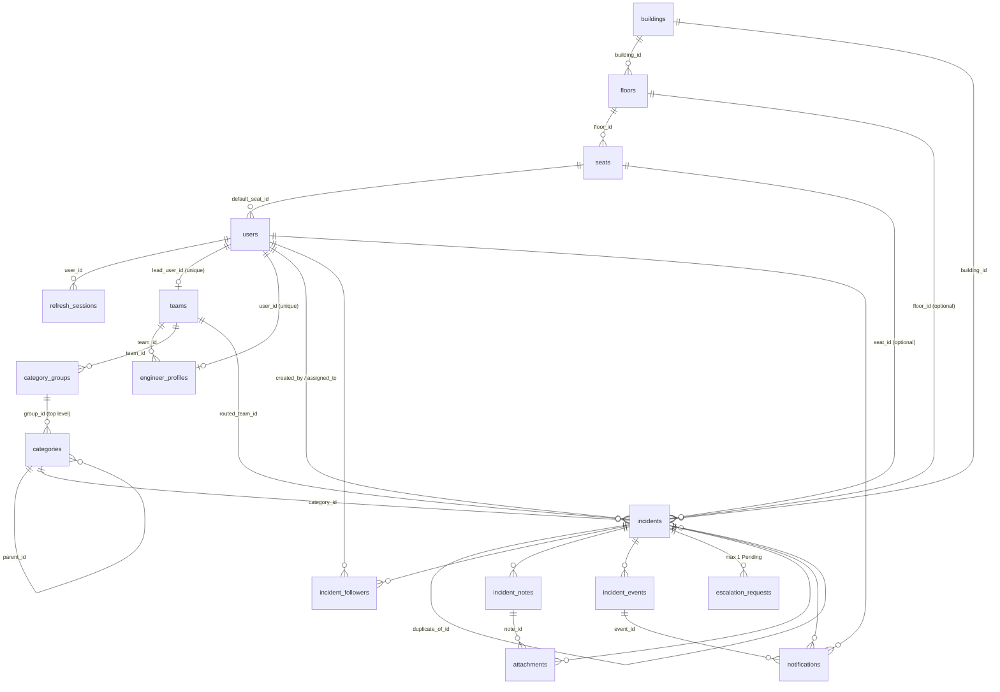

# ACME Incidents: implementation reference

This document covers the facility incident management system: the backend service, the React frontend, and the PostgreSQL database. For each feature it says how the feature is implemented and where the code lives (`file:line`). Use it to find code quickly. For product requirements, see [facility-PRD-v1.1.md](facility-PRD-v1.1.md). For deployment steps, see [facility-backend-deployment.md](facility-backend-deployment.md).

Line numbers were checked against the code when this document was written (October 2026). They will drift as the code changes, so treat them as pointers and confirm against the file.

## Contents

- Part 0: system overview (this section)
- [Part 1: backend implementation](#part-1--backend-implementation): Lambda entry points, cross-cutting mechanisms, every HTTP endpoint, internal modules
- [Part 2: frontend implementation](#part-2--frontend-implementation): routing, API client, pages, components, tests
- [Part 3: database implementation](#part-3--database-implementation): tables, relationships, migrations, seeding, cloud database

## 0.1 What the system does

Employees report facility problems: broken monitors, Wi-Fi, leaks, badge readers and so on. From there:

- **Routing:** each ticket goes to a team based on its category. If routing fails, it goes to admin triage.
- **Engineers:** they acknowledge, work, block and resolve tickets, and add public and internal notes and photos.
- **Reporters:** they confirm the fix or reopen the ticket, follow similar tickets, and can request an escalation.
- **Admins:** they decide escalations, manage people, teams and locations, and see dashboards and SLA status.
- **Scheduled jobs:** these auto-close resolved tickets, send SLA alerts and clean up abandoned uploads.

Roles are stored in `users.roles`:

| Role | How it's stored | Main abilities |
|---|---|---|
| Employee | no role in the list | Report tickets, see their own and followed tickets, confirm or reopen, request escalation |
| Engineer | `engineer` | Work assigned tickets (status changes, notes, photos), set their own availability |
| Team lead | `lead` | See their team's tickets and internal notes, return tickets to triage, team summary |
| Admin | `admin` | Everything: triage, assignment, escalation decisions, people, teams, facilities, dashboards |

## 0.2 Architecture

```text
Browser (React SPA)
   │  https://<cloudfront>/            → S3 website bucket (frontend/dist)
   │  https://<cloudfront>/api/facility-service/api/v1/...
   ▼
CloudFront ──► Lambda Function URL ──► function.handler (Mangum + FastAPI)
                                          │  strips /api/facility-service prefix
                                          ▼
                                   facility.main:app  (/api/v1/...)
                                          │ SQLAlchemy async (asyncpg, TLS)
                                          ▼
                                   Aurora PostgreSQL 17 (Serverless v2)
                                          │
  Browser ⇄ S3 attachments bucket (presigned POST/GET, private)
  Secrets Manager: <APP_NAME>/facility → jwt_secret
```

| Layer | Technology | Location |
|---|---|---|
| Frontend | React 19, Vite 7, react-router 7, Vitest + MSW | `frontend/` |
| Backend | Python 3.13, FastAPI, SQLAlchemy 2 (async), Alembic, Mangum | `backend/facility-service/` |
| Database | PostgreSQL. Locally: a native cluster on port 55439. On AWS: Aurora PostgreSQL 17 Serverless v2. | `backend/facility-service/facility/models/`, `migrations/` |
| Hosting | S3 + CloudFront (frontend), Lambda Function URL (API), S3 (photos) | `infra/*.tf` |

## 0.3 Request flow: one example

When a reporter submits a new ticket from the Report page:

1. `frontend/src/pages/Report.jsx` collects the category, location and description, then calls `api.createIncident()` in `frontend/src/api.js`. That sends `POST {BASE}/incidents` with the in-memory access token.
2. In the cloud, `BASE` is `${VITE_API_URL}/api/facility-service/api/v1` (see `servicePrefix` in `api.js`). CloudFront forwards the request to the Lambda.
3. `backend/facility-service/function.py` (`handler`) removes the `/api/facility-service` prefix and passes the request to FastAPI.
4. `facility/routers/incidents.py` (`POST /incidents`) checks the request and fills in the reporter's default seat if no location was given. It numbers the ticket from `incident_number_seq` (`INC-000123`) and calls `facility/routing.py` to pick a team and engineer. It then writes `incident_events` rows and notifications, and commits.
5. `Incident.set_due_times()` in `facility/models/incident.py` sets the SLA due times from the ticket's priority.
6. The frontend shows where the ticket was routed. Engineers see it on their Board page (`frontend/src/pages/Board.jsx`).

## 0.4 Running and testing

| Task | Command |
|---|---|
| Backend local DB | `bash bin/facility-local.sh init`, then `migrate`, then `seed --demo` (set `FACILITY_PG_BIN` if PostgreSQL isn't on PATH) |
| Backend API | `bash bin/facility-local.sh serve` (port 8019) |
| Backend tests | `bash bin/facility-local.sh test`: about 190 tests on a real PostgreSQL, coverage target 70% (currently about 92%) |
| Frontend | `cd frontend && npm install --legacy-peer-deps && npm run dev` (port 3000; proxies `/api` to 8019) |
| Frontend tests / lint / build | `npm test`, `npm run lint`, `npm run build` |
| Deploy to AWS | `bash bin/deploy-backend.sh aws`, then `bash bin/deploy-frontend.sh aws` |
| Migrate or seed in AWS | `bin/facility-aws-migrate.sh` (`OPERATION=migrate` or `showcase`) |

---


# Part 1 — Backend implementation


Paths are relative to `backend/facility-service/`. Database tables and migrations are covered in Part 3. Each endpoint's `file:line` points at its route decorator; the handler `def` is on the next line.

---

### 1. Lambda entrypoints

| File | Function | How it works |
|---|---|---|
| `function.py:9` | `adapter = Mangum(app, lifespan="off")` | ASGI-to-Lambda adapter. Startup/shutdown lifespan hooks are turned off. |
| `function.py:12` | `handler(event, context)` | Accepts only HTTP events: `requestContext` must contain `http` (Function URL / HTTP API v2), or the event must have `httpMethod` (REST v1). Anything else raises `ValueError("HTTP events only…")`. It deep-copies the event and removes the CloudFront prefix `/api/facility-service` from `path`, `rawPath` and `requestContext.http.path`, using `"/"` if nothing is left. It then calls Mangum. For example, `/api/facility-service/api/v1/incidents` becomes `/api/v1/incidents`. |
| `migration_handler.py:29` | `handler(event, context)` | Control-plane only. It rejects any event with `requestContext`, and any `operation` other than `migrate` or `showcase`. Both operations first run `alembic upgrade head` using `alembic.ini` next to the file (line 40). `migrate` then runs `seed(include_demo=False)`. `showcase` runs `seed(include_demo=True, incidents=clamp(event.incidents, 0..200, default 120), showcase=True, put_object=_put_object())`. It returns `{"status": "migrated"|"seeded", "seed": {...}}`. Showcase needs `FACILITY_ALLOW_DEMO_SEED=true` and a strong `DEMO_PASSWORD` (checked by `seed.demo_allowed`). |
| `migration_handler.py:13` | `_put_object()` | Returns a `put(key, body, content_type)` closure that wraps the `S3Storage(...).client.put_object` call for the attachments bucket. Returns `None` when no bucket is configured, so showcase photos are skipped. |
| `jobs_handler.py:14` | `handler(event, context)` | Scheduled jobs Lambda; the docstring says EventBridge runs it every 15 minutes. It rejects HTTP events. It builds `get_storage()` only if `attachments_bucket` is set, then runs `asyncio.run(run_jobs(SessionLocal, storage, dry_run=bool(event.get("dry_run"))))`. It logs `{"event": "jobs_run", ...}` as JSON and returns the result dict. |

CLI entrypoints (not Lambda):
- `python -m facility.seed [--demo] [--incidents N] [--showcase]` (`seed.py:854`)
- `python -m facility.sessions cleanup` (`sessions.py:43`)

---

### 2. Cross-cutting mechanisms

#### 2.1 Configuration resolution (`facility/config.py`)
- `Settings` (`config.py:11`) is a pydantic-settings class. It uses `env_prefix="FACILITY_"`, reads `.env`, ignores extra variables, and has `hide_input_in_errors`. A singleton `settings = Settings()` is created at `config.py:148`. Importing the module never reads secrets or opens connections.
- Variables that take the `FACILITY_` prefix:
  - `FACILITY_DATABASE_URL` (must start with `postgresql+asyncpg://`; validator `postgres_only` at `:43`)
  - `FACILITY_JWT_SECRET`
  - `FACILITY_SECRET_ARN`
  - `FACILITY_ALLOWED_ORIGINS` (a list)
  - `FACILITY_ACCESS_MINUTES` (default 15)
  - `FACILITY_REFRESH_DAYS` (default 7)
  - `FACILITY_ATTACHMENTS_BUCKET` (empty means attachments are off and return 503)
  - `FACILITY_ATTACHMENTS_ENDPOINT_URL` (MinIO)
  - `IS_LOCAL` / `FACILITY_IS_LOCAL`
- Variables without the prefix: `POSTGRES_HOST`, `POSTGRES_PORT` (default 5432), `POSTGRES_USER`, `POSTGRES_PASS`, `POSTGRES_NAME`, `APP_NAME`.
- `validate_origins` (`:51`) allows exact origins only: no path, query, fragment, userinfo or `*`. Outside local mode, origins must be HTTPS.
- `secret_values()` (`:70`) looks up the secret named by `secret_arn`, or else `f"{APP_NAME}/facility"`. It calls Secrets Manager lazily, expects a JSON object, and caches it in `_secret_cache`. Any failure becomes `RuntimeError("Facility secret is unavailable or invalid")`.
- `resolved_jwt_secret()` (`:89`) uses the env `FACILITY_JWT_SECRET` first, then the secret's `jwt_secret` or `FACILITY_JWT_SECRET` key.
- `resolved_database_url()` (`:110`) resolves in this order:
  1. `FACILITY_DATABASE_URL`.
  2. If any of host/user/pass/name is missing from env, it loads the secret and uses `database_url` or `FACILITY_DATABASE_URL` from it if present.
  3. Otherwise it builds the URL field by field: the env value wins, then the secret keys (`POSTGRES_HOST`|`host`, `POSTGRES_USER`|`username`, `POSTGRES_PASS`|`password`, `POSTGRES_NAME`|`dbname`).
  - For the port, the secret's `POSTGRES_PORT`|`port` comes **before** the env `POSTGRES_PORT`, and only applies when the secret was loaded.
  - It URL-quotes the parts and wraps IPv6 hosts in brackets. If nothing resolves it raises `RuntimeError("PostgreSQL connection is not configured")`.
- `resolved_origins()` (`:96`): in local mode it adds `http://localhost|127.0.0.1` on ports `5173` and `8019`, then de-duplicates.
- `cookie_secure` (`:143`) is `not is_local`.

#### 2.2 Database session (`facility/database.py`)
- `get_engine()` (`:24`) lazily creates an async engine with `NullPool`, which suits Lambda. Outside local mode it passes `connect_args={"ssl": "require"}`.
- `SessionLocal()` (`:36`) returns a new `AsyncSession` with `expire_on_commit=False`.
- `get_db()` (`:41`) is the FastAPI dependency. It gives one session per request, rolls back on exception, and never commits implicitly; handlers commit explicitly.
- `Base` (`:17`) is the declarative base.

#### 2.3 Authentication
- **Access token** (`security.py:80` `create_access_token`):
  - HS256 JWT with claims `sub`=user id, `ver`=`user.token_version`, `sid`=refresh-session family id, `iat`, `exp` (now + `access_minutes`, i.e. 15 min), `iss="acme-facility"`, `aud="facility-service"`, `jti` (random hex).
  - The SPA keeps it in memory and sends it as `Authorization: Bearer`.
  - `decode_access_token` (`:99`) requires all eight claims. An expired token gives 401 `token_expired`; any other failure gives 401 "Invalid access token".
  - `signing_secret()` (`:69`) returns 503 "Authentication is not configured" if the secret can't be resolved or is shorter than 32 bytes.
- **Refresh token**:
  - `new_refresh_token()` (`security.py:123`) is `token_urlsafe(48)` (384 bits). Only its SHA-256 is stored (`hash_refresh_token`, `:118`) in `RefreshSession.token_hash`.
  - Cookie `facility_refresh` (`auth.py:31`, set at `auth.py:108`): HttpOnly, `SameSite=Strict`, `Secure` unless local, `path=/`, `max_age = refresh_days*86400`.
- **Per-request check** (`dependencies.py:19` `authenticated_user`), all against the database:
  - The user must exist, be `is_active`, and have `token_version == claims.ver`.
  - A live `RefreshSession` must exist in the same family (`sid`): not revoked, not rotated, not expired.
  - So logout, a password change or deactivation invalidates outstanding access tokens immediately.
  - Roles always come from the DB row, never from the JWT.
- `current_user` (`dependencies.py:51`) also blocks accounts with `must_change_password` (403 `password_change_required`). `/auth/me` and `/auth/change-password` use the looser `authenticated_user`.
- `require_admin` (`dependencies.py:64`) requires `"admin" in user.roles`, else 403.
- **token_version revocation**: bumped on password change (`auth.py:344`) and on admin deactivation of a user (`people.py:323-325`). Both also call `revoke_sessions` (`auth.py:121`).
- **Lockout** (`auth.py:178` `login`):
  - The user row is locked `FOR UPDATE`, so failures serialize across Lambda instances.
  - Unknown, inactive or locked accounts spend a dummy bcrypt check (`security.py:53` `dummy_password_hash`) to keep timing uniform, then return the generic 401.
  - Wrong password: timestamps in `failed_login_at` (JSON list) are pruned to a rolling 15-minute window and the new one is appended. At ≥5 failures, `locked_until = now + 15 min`. This is committed, then 401 is returned.
  - Success clears both fields.
  - A locked account gets the same generic 401, **not 429**. The `429 → "locked"` mapping in `main.py:59` is never produced.
- **Refresh rotation** (`auth.py:259`):
  - `locked_refresh` (`:231`) locks the user, then the session (same lock order as password change).
  - Presenting a session that is already revoked or rotated counts as replay: the whole family is revoked and 401 returned.
  - Expired session or inactive user: that session is revoked, 401.
  - Otherwise it issues a successor in the same family and marks the old one `revoked_at = rotated_at = now` with `replaced_by_id = successor.id`.
- **CSRF / same-origin** (`auth.py:88` `require_same_origin`), used on register, login, refresh, logout and change-password:
  - Rejects `Sec-Fetch-Site: cross-site`.
  - The `Origin` header (or the origin of `Referer`) must equal the request's own origin or a configured origin.
  - A browser request (Sec-Fetch-Site present and not `none`) with no origin is rejected.
  - Clients that send none of these headers are allowed.
- **Password / email policy**:
  - `validate_password` (`security.py:18`): ≥10 characters, at least one letter and one digit, ≤72 UTF-8 bytes.
  - `hash_password` (`:47`): bcrypt cost 12.
  - `verify_password` (`:59`): rejects passwords over 72 bytes and never truncates.
  - `normalize_email` (`:32`): lowercases and requires an ASCII dot-atom local part at exactly `@acme.inc`.
- **Session retention** (`sessions.py:16` `cleanup_expired_sessions`): deletes refresh sessions expired more than 7 days ago, unless another retained session points to them via `replaced_by_id`. It runs only from the CLI (`main` at `:43`); it is **not** part of the scheduled jobs.

#### 2.4 Error format (`facility/main.py`, `facility/errors.py`)
- Every error has the shape `{"error": {"code": str, "message": str, "details": {...} | [...]}}`, built by `error_response` (`main.py:48`).
- Default codes by status: 401 `unauthenticated`, 403 `forbidden`, 404 `not_found`, 409 `conflict`, 422 `validation_error`, 428 `precondition_required`, 429 `locked`, 503 `unavailable`, 500 `internal_error`, anything else `request_error`.
- `fail(status, code, message, **details)` (`errors.py:6`) raises an `HTTPException` whose dict detail carries a specific `code`. `http_error` (`main.py:77`) moves the non-`code`/`message` keys into `details` and keeps exception headers such as `WWW-Authenticate`.
- `invalid_input` (`main.py:97`): for 422 Pydantic errors, `details` is a list of `{location, message, type}` with no input values. The code becomes `skills_invalid` if any error is under `body.skills`.
- `constraint_error` (`main.py:113`): an `IntegrityError` becomes 409 "A uniqueness or reference constraint was violated" with no SQL text.
- `unexpected_error` (`main.py:119`): returns 500 with `details.request_id`, and sets the `X-Request-ID` and `Cache-Control: no-store` headers. Only the exception type name is logged.
- `request_audit` middleware (`main.py:143`): assigns a `request_id` (uuid4 hex), sets `X-Request-ID` and `Cache-Control: no-store` on every response, and logs JSON `{request_id, method, status, elapsed_ms}` with no body.
- CORS (`main.py:38`): `resolved_origins()`, credentials allowed, methods GET/POST/PATCH/PUT/DELETE/OPTIONS, allowed headers `Authorization`, `Content-Type`, `If-Match`; exposes `X-Request-ID` and `ETag`.
- Common domain codes: `stale_version`, `final_state`, `invalid_transition`, `no_assignee`, `escalation_pending`, `escalation_cooldown`, `escalation_not_pending`, `edit_window_closed`, `filter_not_permitted`, `last_admin`, `team_needs_lead`, `has_assigned_incidents`, `has_open_incidents`, `duplicate`, `duplicate_email`, `invalid_current_password`, `password_change_required`, `token_expired`, `location_inactive`, `location_required`, `group_inactive`, `team_has_members`, `team_inactive`, `engineer_in_other_team`, `engineer_profile_required`, `attachment_limit`, `upload_expired`, `upload_incomplete`, `attachment_invalid`, `invalid_duplicate_target`, `not_returnable`, `service_unavailable`.

#### 2.5 Optimistic concurrency (If-Match / ETag)
- The ETag is `"<updated_at.isoformat()>"`. It is set by `GET /incidents/{id}` and by every incident mutation that returns through `_finish` (`incidents.py:296`). `_finish` flushes, projects, runs `notifications.commit`, then sets the header.
- `check_match` (`permissions.py:155`):
  - A missing `If-Match` gives 428 `precondition_required`.
  - It strips `W/` and quotes, and requires a timezone-aware ISO timestamp.
  - If that timestamp doesn't equal the record's `updated_at` in UTC, it returns 409 `stale_version`.
- `touch` (`permissions.py:176`) sets `updated_at = max(now, previous + 1µs)`, so the version always moves forward.
- Endpoints that require `If-Match`:
  - Checked against the incident version: PATCH incident, assign, priority, transitions, escalation request, escalation decision, POST note, duplicate, return-to-triage.
  - Checked against the **note's** `updated_at`: PATCH `/notes/{id}` and `/notes/{id}/hide`.
  - Note endpoints return the *note's* ETag, so clients must reload the incident before their next incident mutation.
- Mutations lock the incident row with `SELECT … FOR UPDATE` plus `populate_existing` (`load_incident(..., lock=True)`, `permissions.py:137`).

#### 2.6 Authorization model (`facility/permissions.py`)
- `Rel` (`:29`) is a frozen dataclass of the caller's relationships to one incident: `creator`, `follower`, `assignee`, `team_lead`, `admin`.
  - `staff_read` = admin, assignee or team lead. These can see internal notes.
  - `readable` = any relationship.
  - `follower_only` = follower with no staff/creator relationship. Such callers get a reduced projection without `description`, `created_by`, `requested_priority` or `latest_escalation`, and the creator's id is masked in notes, timeline and attachments.
- `can_staff` (`:60`) is the action permission: admin, or an engineer who is the current `assigned_to`. **Team leads read internal content but cannot perform staff actions.**
- `readable_clause` (`:76`) is the SQL predicate used by lists, counts and notification recipients. Admin sees everything. Otherwise it is creator OR follower OR (engineer and assignee) OR (lead and the assignee is in the lead's active team, via `led_members` at `:67`).
- `staff_read_clause` (`:96`) is the SQL version of `staff_read`.
- `relationship` (`:108`) computes `Rel` from current DB state.
- `load_incident` (`:137`) applies `readable_clause`, so an unreadable incident gives 404 `not_found`, never 403.
- `event` (`:187`) appends an `IncidentEvent` (actor `None` means system) and queues `(entry, incident)` in `db.info["pending_events"]` for notification fan-out.
- `require_nonfinal` (`:211`) returns 409 `final_state` for Closed or Cancelled incidents. `require_permission` (`:217`) returns 403 `forbidden`.

#### 2.7 Incident status workflow
`VALID_TRANSITIONS` (`enums.py:259`):

| From → To | Who (`incidents.py:966-973`) | Required input / side effects (`incidents.py:982-1043`) |
|---|---|---|
| Open → In Progress | staff (admin or assigned engineer) | Requires an assignee (409 `no_assignee`). Sets `first_in_progress_at` and `acknowledged_at` if unset. |
| Open → Cancelled | admin or creator | `reason` required. Sets `cancelled_at`. Final: supersedes any pending escalation. |
| In Progress → Blocked | staff | `reason` must be a `BlockedReason` value and `note` is required. Adds a note with the given visibility and sets `blocked_reason` and `blocked_since`. |
| Blocked → In Progress | staff | Records the previous reason and `blocked_since` in the event, then clears both. |
| In Progress → Resolved | staff | Requires a **public** note. Sets `resolved_at`. The event payload records `assigned_to`/`assignee`, which is how resolution is credited in metrics. |
| Resolved → Closed | admin or creator | `close_kind` = `confirmed` (creator) or `admin`. Sets `closed_at`. Supersedes any pending escalation. |
| Resolved → In Progress (reject resolution) | admin or creator | Requires a public note. Clears `resolved_at`, increments `reopen_count`, and records `previous_resolved_at`. |

Other ways to reach Closed:
- Auto-close 72 h after resolution (`jobs.auto_close` → `workflow.close` with `CloseKind.AUTO`).
- Duplicate close by an admin (`CloseKind.DUPLICATE`).

Every transition emits a `STATUS_CHANGED` event with `{from, to, …extra}`. Final statuses (Closed, Cancelled) are read-only.

#### 2.8 SLA (`facility/sla.py`, `enums.py:233-242`, `models/incident.py:114,164`)
- Due times are set when the incident is created and recomputed on priority change; they are never computed from the current time.
  - `ack_due_at = created_at + ack_hours` and `resolve_due_at = created_at + resolve_hours`.
  - Hours by priority: Critical (1, 4), High (4, 24), Medium (24, 72), Low (48, 120).
  - `Incident.set_due_times()` (`models/incident.py:114`) does the calculation. A `before_insert` listener (`:164`) fills them for any insert. Changing the due time resets the matching `*_alerted_at` markers so alerts fire again.
- The SLA state is computed, never stored:
  - `sla_state` (`sla.py:26`) and its SQL twin `sla_state_sql` (`:56`).
  - Resolved or Closed: `met` if `resolved_at <= resolve_due_at`, otherwise `missed`, or `None` if never resolved.
  - Statuses other than Open, In Progress and Blocked (i.e. Cancelled): `None`.
  - Active statuses: the windows are resolve, plus ack while unacknowledged. `breached` if now > any due time; `at_risk` once ≥75% of any window has elapsed (`SLA_AT_RISK_FRACTION`); otherwise `on_track`.
- `reached_risk` (`:49`) is the SQL 75% test. `next_due_sql` (`:81`) is ack due while unacknowledged, else resolve due; it drives `sort=sla_due`.
- Acknowledgment happens on Open → In Progress, or when the assignee posts a public note (`incidents.py:440`).

#### 2.9 Routing and auto-assignment (`facility/routing.py`)
- `route_new_incident` (`:160`) runs on create:
  1. Find the top-level category, its `CategoryGroup`, and that group's owning `Team`.
  2. If the group or team is missing or inactive, set `triage_reason = unrouted_group` and leave the ticket unassigned.
  3. Otherwise set `routed_team_id` and rank the top 5 **on-duty** engineers of that team.
  4. Lock and re-check each in turn with `still_eligible` (`:129`: active user, engineer role, active profile, same team, not Off-duty).
  5. Assign the first that passes. If none pass, set `triage_reason = no_engineer`.
  6. On success: set `assigned_to` and `assigned_at`, clear `triage_reason`, and emit an `ASSIGNED` event with `via: "auto_route"` and actor `None`.
  - It returns `{"status": "assigned"|"triage", ...}`, which `POST /incidents` exposes as `routing`.
- `ranked_engineers` (`:49`) ranks active engineers by:
  1. Skill matches the top-level category name (JSONB `@>`).
  2. Availability: Available, then Busy, then Off-duty (`AVAILABILITY_RANK` at `:24`).
  3. Fewest non-final assigned tickets (`open_count_sql` at `:39`).
  4. Home building matches the incident building.
  5. Name, then id.
  - Each result carries `match_reasons`.
  - Can be filtered by team, on-duty only, and limit.
- `top_category` (`:31`) returns the parent when given a subcategory.
- Return to triage: the assignee or their team lead can unassign an Open ticket (`triage_reason=returned`, `route_return_count++`). This notifies all admins and the previous assignee.

#### 2.10 Notifications (`facility/notifications.py`)
- Events queued by `permissions.event` become notifications **in the same transaction** through `commit(db)` (`:208`), which calls `dispatch` (`:194`) and then `db.commit()`.
- `notify` (`:47`) filters recipients:
  - Drops `None` values and the actor.
  - Keeps only active users.
  - Keeps only users who can read the ticket now (`readable_clause`), unless `require_read=False` or the user is listed in `exempt`.
- `_fan_out` (`:103`) rules. The "audience" is creator, assignee and followers.
  - `STATUS_CHANGED`: audience gets a templated message (`_status_message` at `:92` has special wording for duplicate, blocked and auto-close).
  - `ASSIGNED`/`UNASSIGNED` with `via=returned_to_triage`: all admins plus the previous assignee (exempt from the read check).
  - Other `ASSIGNED`/`UNASSIGNED`:
    - the new assignee gets "assigned to you";
    - the previous assignee gets "no longer assigned to you" (no read check);
    - creator and followers get "new assignee" or "waiting for assignment".
  - `NOTE_ADDED`: internal notes go only to the assignee; public notes go to the audience. This is skipped if the same batch has a status or decision event for that incident (the "covered" set).
  - `ESCALATION_APPROVED`/`REJECTED`: audience.
  - No notifications are sent for `CREATED`, `DETAILS_CHANGED`, `PRIORITY_CHANGED`, `ESCALATION_REQUESTED`, `NOTE_EDITED`, `NOTE_HIDDEN`, `DUPLICATE_MARKED` or `ATTACHMENT_ADDED`.
  - `NotificationType.DUPLICATE_MARKED` and `IncidentEventType.AUTO_CLOSED` are defined in enums but never emitted.
- Message templates never include note text.

#### 2.11 Scheduled jobs (`facility/jobs.py`)
- `run_jobs` (`:125`) takes the session-level advisory lock `pg_try_advisory_lock(624030121)`. If it is held, it returns `{"status": "skipped"}`. `dry_run` only runs `SELECT 1`. Otherwise it runs the three steps below in turn, then unlocks.
  1. `auto_close` (`:32`) loops, each pass in its own transaction: select one Resolved incident with `resolved_at <= now() - 72h`, `FOR UPDATE SKIP LOCKED`, then `workflow.close(..., CloseKind.AUTO)` and `notifications.commit`.
  2. `sla_alerts` (`:67`): for each of the four `ALERTS` (`:58`: ack at-risk, ack breach, resolve at-risk, resolve breach), one `UPDATE incidents SET <marker>=now() WHERE marker IS NULL AND window active AND threshold reached RETURNING id`. Then it notifies the assignee and all active admins (`sla_at_risk` / `sla_breached`). Each threshold fires once per due-time revision.
  3. `cleanup_uploads` (`:101`): `DELETE` attachments that are still `pending` and older than 1 h, `RETURNING s3_key`. It commits, then deletes the S3 objects, ignoring errors.
- It returns `{status, auto_closed, sla_alerts, uploads}`.

#### 2.12 Workflow helpers (`facility/workflow.py`)
- `supersede_pending` (`:11`): when an incident becomes final, it locks any pending `EscalationRequest`, marks it `Superseded` with `decided_at`, `decided_by` and the reason "Incident became X", and emits `ESCALATION_SUPERSEDED`.
- `close` (`:35`): sets Closed, `closed_at` and `close_kind`, clears the blocked fields, calls `touch`, emits `STATUS_CHANGED {from, to: Closed, close_kind, ...extra}`, then calls `supersede_pending`. Used by auto-close and duplicate close.

#### 2.13 Attachment presign flow (`facility/storage.py`, `routers/attachments.py`)
1. **Presign** (`POST /incidents/{id}/attachments/presign`): checks permission, inserts an `Attachment` row with `status=pending` and key `incidents/{incident_id}/{attachment_id}`, then returns `S3Storage.presign_post` (`storage.py:52`). The presigned POST fixes the key and `Content-Type`, sets `content-length-range` to 1..5 MiB, and expires in 300 s.
2. The browser POSTs the file directly to S3.
3. **Finalize** (`POST /incidents/{id}/attachments`):
   - `HEAD` the object for its size. If it is missing, the row stays pending and the API returns 409 `upload_incomplete` so the client can retry.
   - Range-GET the first 32 bytes (`head_bytes`) and check the magic bytes (`signature_matches`, `storage.py:109`, for JPEG, PNG, WEBP or HEIC).
   - On mismatch or oversize: status `rejected`, delete the object, 422 `attachment_invalid`.
   - Otherwise: status `accepted`, store the actual size, and emit `ATTACHMENT_ADDED` with the linked note's visibility.
4. **Download** (`GET /attachments/{id}`): `presign_get` (`storage.py:79`) returns a 300 s GET URL with `ResponseContentDisposition=inline`.
- Abandoned pending rows are cleaned up after 1 h by the jobs Lambda.
- `S3Storage.__init__` (`storage.py:33`): with `endpoint_url` it uses MinIO. Otherwise it uses the regional endpoint `https://s3.{region}.amazonaws.com` with SigV4 and virtual addressing, so browsers don't hit the global-endpoint redirect.
- `get_storage` (`:100`) returns the test override if set. Otherwise it returns 503 `service_unavailable` if no bucket is configured. `set_storage` (`:94`) installs the test override.
- `Storage` Protocol (`:16`): `presign_post`, `size`, `head_bytes`, `delete`, `presign_get`.

---

### 3. HTTP endpoints

Routes are mounted under `/api/v1` (`main.py:178-189`), and CloudFront adds `/api/facility-service` in front. Routers are included in this order: auth, people, teams, facilities, coordination, incidents, attachments, notifications, dashboards. Coordination comes before incidents so `/incidents/similar` isn't parsed as an id. "Authenticated" means `current_user`: valid token, live session, and no pending password change.

#### 3.0 Health (`facility/main.py`, NOT under /api/v1)
| Method | Path | Handler | file:line | Who | Description |
|---|---|---|---|---|---|
| GET | `/health` and `/api/health` (the latter hidden from the schema) | `health` | `facility/main.py:164-165` | Public | Runs `SELECT 1` through `SessionLocal`. Returns `{"status":"healthy"}`, or 503 "Database unavailable". Exposes no version or host. |

#### 3.1 Auth (`facility/routers/auth.py`, prefix `/auth`)
| Method | Path | Handler | file:line | Who | Description |
|---|---|---|---|---|---|
| POST | `/auth/register` | `register` | `auth.py:157` | Public (same-origin check) | Self-registers an employee (`roles=[]`). The strict model forbids extra fields such as roles. Email must be `@acme.inc` and the password must pass policy. A duplicate gives 409 `duplicate_email`. Returns `user_output` with 201. |
| POST | `/auth/login` | `login` | `auth.py:178` | Public (same-origin) | Locks the user row and runs the lockout logic (§2.3). On success it issues an access token and sets the refresh cookie. Returns `{access_token, token_type, expires_in, user}`. Checks that the signing secret exists first (503 if not). |
| GET | `/auth/me` | `me` | `auth.py:210` | Any authenticated user, including `must_change_password` | Returns the account plus `engineer` (profile id, active flag, availability, skills, team_id) and `leads_team`. |
| POST | `/auth/refresh` | `refresh` | `auth.py:259` | Holder of the refresh cookie (same-origin) | One-time rotation within the session family. Replay of a used token revokes the whole family. Returns a new access token and sets a new cookie. |
| POST | `/auth/logout` | `logout` | `auth.py:291` | Anyone (same-origin) | Idempotent. Revokes the presented session's whole family, which immediately kills access tokens carrying that `sid`, and deletes the cookie. Returns 204. |
| POST | `/auth/change-password` | `change_password` | `auth.py:315` | Authenticated user, including `must_change_password` (same-origin) | Locks the user and verifies the current password (a wrong one gives 422 `invalid_current_password`, not 401). The new password must differ. It rehashes, clears `must_change_password` and the lockout fields, bumps `token_version`, revokes all sessions and issues a new session. |

#### 3.2 People (`facility/routers/people.py`)
| Method | Path | Handler | file:line | Who | Description |
|---|---|---|---|---|---|
| GET | `/users` | `list_users` | `people.py:208` | Admin | Paginated (`page`, `page_size` ≤ 100). `q` is an escaped ILIKE search on email and name. Ordered by name, then id. |
| PATCH | `/users/me` | `update_self` | `people.py:263` | Authenticated | Updates `full_name` and/or `default_seat_id`. The seat must be active with an active floor and building (422 `location_inactive`); null clears it. Locks the user row. |
| PATCH | `/users/{user_id}` | `update_user` | `people.py:280` | Admin | Edits roles, `is_active` or `full_name` under the people advisory lock (`people_guard`, `:138`). Rules: <br>• Removing or deactivating the last active admin gives 409 `last_admin`. <br>• Dropping the lead role or deactivating the lead of an active team gives 409 `team_needs_lead`. <br>• Deactivating, or removing the engineer role, needs zero non-final assignments (409 `has_assigned_incidents` with `affected_count`). <br>• Adding the engineer role needs an active profile (409 `engineer_profile_required`). <br>• Removing the engineer role deactivates the profile and detaches it from its team. <br>• Deactivating bumps `token_version` and revokes sessions. |
| GET | `/engineers` | `list_engineers` | `people.py:334` | Staff (admin or engineer role; `require_staff` at `:202`) | Paginated engineer profiles with `q` and `is_active` filters. Each includes workload and per-status counts of non-final assignments, and the user projection. |
| POST | `/engineers` | `create_engineer` | `people.py:372` | Admin | Under `people_guard`. Exactly 2 distinct skills are required (`unique_skills`). `team_id` must be an active team and home buildings must exist. <br>• New email: creates the user with `must_change_password=True`, using a supplied or generated temporary password that is returned **once** as `temporary_password`. <br>• Existing active user: adds the engineer role; supplying a temporary password gives 422. <br>• Inactive user or existing profile: 409. |
| PATCH | `/engineers/me/availability` | `set_own_availability` | `people.py:422` | Active engineer with an active profile | Sets the caller's own availability (Available, Busy or Off-duty). |
| GET | `/engineers/{engineer_id}` | `get_engineer` | `people.py:434` | Staff | One engineer profile summary, looked up by **profile id** (not user id). |
| PATCH | `/engineers/{engineer_id}` | `update_engineer` | `people.py:445` | Admin | Under `people_guard`; locks the user. Edits phone, `is_active`, availability, skills (exactly 2), `home_building_ids` and `full_name`. <br>• Deactivating needs zero non-final workload and clears `team_id`. <br>• Reactivating needs an active user account and re-adds the engineer role. <br>• Only `phone` may be null. |

#### 3.3 Teams and category groups (`facility/routers/teams.py`)
| Method | Path | Handler | file:line | Who | Description |
|---|---|---|---|---|---|
| GET | `/teams` | `list_teams` | `teams.py:136` | Admin (all teams) or lead (own team only); others get 403 | `team_output` (`:67`): lead, active members (with availability and skills), owned category groups, and a `warnings: ["no_member_on_duty"]` flag when active groups exist but nobody is on duty. |
| GET | `/teams/{team_id}` | `get_team` | `teams.py:149` | Admin, or the team's lead | Returns 404 for anyone else. |
| POST | `/teams` | `create_team` | `teams.py:157` | Admin | Under `people_guard`. `_grant_lead` (`:126`): the lead must be active and must not already lead a team (409 `duplicate`). Adds the lead role. |
| PATCH | `/teams/{team_id}` | `update_team` | `teams.py:168` | Admin | Under `people_guard`; locks the team. <br>• Changing lead moves the lead role from the old lead to the new one. <br>• Deactivating needs zero active members (409 `team_has_members`) and detaches inactive leftovers. <br>• Reactivating needs an active lead (409 `team_needs_lead`) and re-grants the role. |
| PUT | `/teams/{team_id}/members` | `set_members` | `teams.py:216` | Admin | Replaces the member list (≤200 user ids). The team must be active (409 `team_inactive`). Every id must have an active engineer profile (422). An engineer in another team gives 409 `engineer_in_other_team`. Members not in the list are detached. |
| GET | `/category-groups` | `list_groups` | `teams.py:256` | Authenticated | All groups, ordered by `sort_order` then name. |
| POST | `/category-groups` | `create_group` | `teams.py:274` | Admin | Creates a group. An optional owning `team_id` must be an active team. |
| PATCH | `/category-groups/{group_id}` | `update_group` | `teams.py:283` | Admin | Edits name, `sort_order`, `is_active` or `team_id`. Setting `team_id` to null sends new tickets in that group to triage. Other fields cannot be null. |

#### 3.4 Facilities: locations and categories (`facility/routers/facilities.py`)
The whole router depends on `current_user` (`facilities.py:17`), so every route requires authentication. Mutations also require admin. Records are never deleted, only deactivated.

| Method | Path | Handler | file:line | Who | Description |
|---|---|---|---|---|---|
| GET | `/buildings` | `list_buildings` | `facilities.py:172` | Authenticated | Paginated (`page_size` 1..100, else 422). Escaped ILIKE `q` on name and code. Includes inactive buildings. |
| POST | `/buildings` | `create_building` | `facilities.py:201` | Admin | Name and code must be unique case-insensitively (`ensure_unique`, `:127`, gives 409 `duplicate` with `field`). |
| PATCH | `/buildings/{item_id}` | `patch_building` | `facilities.py:216` | Admin | Locks the row. Deactivating while any non-final incident references the building gives 409 `has_open_incidents` with `count` (`guard_location`, `:116`). Null is rejected except for `address`. |
| GET | `/buildings/{building_id}/floors` | `list_floors` | `facilities.py:234` | Authenticated | Floors ordered by `level_number`; 404 for an unknown building. |
| POST | `/buildings/{building_id}/floors` | `create_floor` | `facilities.py:254` | Admin | The parent building must be active (409). `level_number` must be between -50 and 200. |
| PATCH | `/floors/{item_id}` | `patch_floor` | `facilities.py:271` | Admin | Locks the building, then the floor. Reactivating needs an active building. Deactivating is guarded by open incidents. |
| GET | `/floors/{floor_id}/seats` | `list_seats` | `facilities.py:293` | Authenticated | Seats ordered by code. |
| POST | `/floors/{floor_id}/seats` | `create_seat` | `facilities.py:309` | Admin | Building and floor must be active. The code must be unique case-insensitively within the floor. |
| POST | `/floors/{floor_id}/seats/bulk` | `bulk_create_seats` | `facilities.py:331` | Admin | Body `{prefix, from, to, pad}` creates `prefix + zero-padded n` for at most 200 seats. All or nothing: any collision gives 409 `duplicate` with `codes`. |
| PATCH | `/seats/{item_id}` | `patch_seat` | `facilities.py:370` | Admin | Locks building, then floor, then seat. Reactivating needs active ancestors. Deactivating is guarded by open incidents. Code stays unique within the floor. |
| GET | `/locations/tree` | `location_tree` | `facilities.py:397` | Authenticated | Nested building → floors → seats. With `active_only=true` (the default), inactive subtrees are excluded. |
| GET | `/categories` | `list_categories` | `facilities.py:423` | Authenticated | Flat list. With `active_only`, keeps only active categories that have an active parent. |
| POST | `/categories` | `create_category` | `facilities.py:439` | Admin | Two levels at most: the parent must be an active top-level category. Subcategories can't set `group_id` (they inherit it). The group must exist and be active (`check_group`, `:151`). Names are unique among siblings. |
| PATCH | `/categories/{item_id}` | `patch_category` | `facilities.py:460` | Admin | Reactivating a child needs an active parent. `group_id` may only be set on top-level categories (null is allowed). The parent is immutable. |

#### 3.5 Coordination (`facility/routers/coordination.py`)
| Method | Path | Handler | file:line | Who | Description |
|---|---|---|---|---|---|
| GET | `/incidents/similar?category_id&floor_id` | `similar_incidents` | `coordination.py:84` | Authenticated (no readability filter; returns previews only) | Duplicate suggestions: up to 5 non-final tickets from the last 7 days on the same floor and in the same top-level category. Each item has id, number, title, status, location names, `age_seconds` and whether the caller already follows it. |
| POST | `/incidents/{id}/follow` | `follow` | `coordination.py:168` | Authenticated, if the ticket is readable or "suggestible" (`_follow_eligible`, `:145`) | Idempotent insert (`ON CONFLICT DO NOTHING`); non-final tickets only; returns 204. **Note:** "suggestible" only checks that the ticket has a floor, is non-final and is ≤7 days old. It does not check that the category matches. |
| DELETE | `/incidents/{id}/follow` | `unfollow` | `coordination.py:182` | Authenticated | Removes the caller's follow, in any state. 404 if they weren't following. Returns 204. |
| POST | `/incidents/{id}/duplicate` | `mark_duplicate` | `coordination.py:196` | Admin; If-Match | The target must be a different ticket that is not Cancelled and not itself a duplicate (409 `invalid_duplicate_target`). Sets `duplicate_of_id`, emits `DUPLICATE_MARKED`, runs `workflow.close(CloseKind.DUPLICATE)` (status event plus escalation supersede), and makes the duplicate's creator a follower of the target. |
| POST | `/incidents/{id}/return-to-triage` | `return_to_triage` | `coordination.py:247` | The assignee engineer, or their team lead; If-Match | Only for Open, assigned tickets (409 `not_returnable`); `reason` must be ≥10 characters. Unassigns, sets `triage_reason=returned`, increments `route_return_count`, and emits `UNASSIGNED` with `via: "returned_to_triage"`. That notifies admins and the previous assignee. |
| GET | `/incidents/{id}/engineer-suggestions` | `engineer_suggestions` | `coordination.py:283` | Admin (non-admins who can't read the ticket get 404 first) | All active engineers ranked by `ranked_engineers` for this ticket's top-level category and building, plus `top_category`. |

#### 3.6 Incidents (`facility/routers/incidents.py`)
| Method | Path | Handler | file:line | Who | Description |
|---|---|---|---|---|---|
| POST | `/incidents` | `create_incident` | `incidents.py:491` | Authenticated | Body: title 5..120, description 10..5000, `category_id`, optional building/floor/seat, `requested_priority` (default Medium). <br>• No location: the user's `default_seat_id` is used, else 422 `location_required`. <br>• `_validate_selection` (`:306`) locks and checks that building, floor and seat are active and correctly nested, and that the category and its parent are active; a top-level category with active children gives 422. <br>• The number comes from `nextval('incident_number_seq')`, formatted `INC-%06d`. Priority = requested priority. <br>• Emits `CREATED`, runs `route_new_incident`, then commits with notifications. <br>• Response: projection, `routing`, ETag; status 201. |
| GET | `/incidents` | `list_incidents` | `incidents.py:530` | Authenticated; always limited by `readable_clause` | Unknown query params give 422. Filters: <br>• `q`: full text (`to_tsvector('english', title‖description) @@ plainto_tsquery`), or ticket number (`INC-000123`, `inc-123` and `123` all match). <br>• Multi-valued `status`, `priority`, `sla_state` (SQL SLA). <br>• Ids: `category_id` (includes children), building/floor/seat, `assigned_to` (UUID or `unassigned`), `category_group_id`. <br>• `scope` `all`/`mine`/`assigned` (`assigned` needs admin or engineer), `unassigned`, `followed`, `public_note=none`, `escalation` (latest state or `none`). <br>• Dates must be timezone-aware: `date_from`/`date_to` (inclusive; `created_from` is an alias of `date_from`), `created_to` (exclusive), `resolved_from`/`resolved_to`, `returned_from`/`returned_to`. <br>• `resolved_by`: matches `assigned_to` in the latest resolve event. <br>Admin-only filters: `created_by`, `routed_team_id`, `triage_reason` (403 `filter_not_permitted` otherwise). `team_id` is allowed for admins or that team's lead. <br>Sort: `created`/`updated`/`priority` (by rank)/`sla_due` (`next_due_sql`), `direction`, stable tie-break. Paged (`page_size` ≤ 100). Items use `incident_projection` (`:199`), which adds `sla_state`, `permissions`, `following`, `people` (id → name) and `latest_escalation` (decision prose is taken from the hide-aware decision note). |
| GET | `/incidents/export.csv` | `export_incidents` (via `add_api_route`) | `incidents.py:846` (function at `:798`) | Same as the list | Its signature is copied from `list_incidents` (`:843`), so the parameters and validation are identical. It pages the list 100 at a time up to 5000 rows. Columns: number, title, status, priority, sla_state, category, building, assignee, created_at, resolved_at, closed_at. Cells starting with `= + - @ \t \r` are prefixed with `'` (`_csv_cell`, `:792`). Sent as an attachment named `incidents.csv`. |
| GET | `/incidents/{id}` | `get_incident` | `incidents.py:851` | Anyone who can read it (else 404) | Projection plus `ETag`. Followers-only get the reduced projection. |
| PATCH | `/incidents/{id}` | `update_incident` | `incidents.py:861` | Staff (admin or assignee) in any non-final status; creator only while Open (409 otherwise); If-Match | Editable: title, description, category, building, floor, seat. Only floor and seat may be null. Changing building resets floor and seat unless they are supplied; changing floor resets seat. Changed parts are re-validated. Emits `DETAILS_CHANGED {fields}`, which sends no notification. |
| POST | `/incidents/{id}/assign` | `assign_incident` | `incidents.py:904` | Admin; non-final; If-Match | `_assign` (`:445`): <br>• Same assignee gives 409. <br>• Reassigning or unassigning needs a `reason`. Unassigning only works while Open. <br>• The assignee must be an active engineer with an active profile (`_active_engineer`, `:369`). <br>• An Off-duty engineer needs `confirm_unavailable=true`, otherwise 409 with `confirmation_required`. <br>• Sets `assigned_at` once and clears `triage_reason`. <br>• Emits `ASSIGNED` or `UNASSIGNED` with `unavailable_override`, which triggers notifications. |
| PATCH | `/incidents/{id}/priority` | `change_priority` | `incidents.py:924` | Admin; non-final; If-Match | Requires a `reason`; the same priority gives 409. Calls `set_due_times()`, which recomputes SLA due times and re-arms alerts, then emits `PRIORITY_CHANGED`. |
| POST | `/incidents/{id}/transitions` | `transition_incident` | `incidents.py:953` | See §2.7 table; If-Match | Validates against `VALID_TRANSITIONS` (409 `invalid_transition`). Body: `status`, `reason`, `note`, `visibility`. Required notes are created atomically through `_add_note`. Emits `STATUS_CHANGED`. Final targets call `supersede_pending`. |
| POST | `/incidents/{id}/escalation` | `request_escalation` | `incidents.py:1047` | Creator only; non-final; If-Match | `reason` 10..500. One pending request at a time (409 `escalation_pending`). 24 h cooldown after the last request of any outcome (409 `escalation_cooldown` with `retry_after`). Creates a Pending `EscalationRequest` and emits `ESCALATION_REQUESTED`; returns 201. |
| POST | `/incidents/{id}/escalation/decision` | `decide_escalation` | `incidents.py:1091` | Admin; non-final; If-Match | Locks the pending request (409 `escalation_not_pending` if none). <br>• **Approve, non-Critical:** `priority` must be at least one level higher; recomputes due times and emits `PRIORITY_CHANGED`; an optional `action_plan` becomes a public note. <br>• **Approve, Critical:** `action_plan` is required and becomes a public note; `priority` must be null or Critical. <br>• **Reject:** `decision_reason` is required and becomes a public note; `priority` and `action_plan` are not allowed. <br>An optional `assigned_to` reassigns through `_assign` with the reason "Escalation decision". Emits `ESCALATION_APPROVED` or `ESCALATION_REJECTED` with `note_id`. |
| GET | `/incidents/{id}/notes` | `list_notes` | `incidents.py:1190` | Readers. Internal notes only for `staff_read` (admin, assignee, team lead) | Hidden notes come back as a tombstone without a body (`note_projection`, `:402`). The creator id is masked for followers-only. Includes a `people` map. |
| POST | `/incidents/{id}/notes` | `create_note` | `incidents.py:1206` | Staff or creator; internal visibility only for staff; non-final; If-Match against the **incident** version | `_add_note` (`:422`) inserts the note and emits `NOTE_ADDED`. A public note by the assignee sets `acknowledged_at`. Touches the incident. Returns the note with the **note's** ETag; 201. |
| PATCH | `/notes/{note_id}` | `edit_note` | `incidents.py:1254` | The note's author, who must still be staff or creator; internal notes only for staff; non-final; If-Match against the note version | `_load_note` (`:1230`) returns 404 when the incident or note can't be seen. Hidden notes give 409. Editing closes 10 minutes after creation (409 `edit_window_closed`). Sets `edited_at`, touches note and incident, and emits `NOTE_EDITED` with the previous and new body for audit. Timeline payloads never include the bodies. |
| POST | `/notes/{note_id}/hide` | `hide_note` | `incidents.py:1300` | Admin; If-Match against the note version (works on final incidents too) | Sets `hidden_at`, `hidden_by` and `hide_reason`, and emits `NOTE_HIDDEN`. Hiding an already-hidden note is a no-op. |
| GET | `/incidents/{id}/timeline` | `get_timeline` | `incidents.py:1337` | Readers | Events in order, cleaned up for the reader: <br>• Payloads are whitelisted by key (`safe_keys`). <br>• Note events are dropped if the note is missing, or internal and the reader isn't staff. <br>• Internal `ATTACHMENT_ADDED` events are dropped for non-staff. <br>• Assign, priority and duplicate reasons and `team_id` are stripped for non-staff. <br>• Hide reasons are kept for admins only. <br>• Escalation decision prose is always removed. <br>• A `hidden` flag is added where relevant, and actor ids are masked for followers-only. <br>`NOTE_ADDED` items embed the note projection. Includes a `people` map. |

#### 3.7 Attachments (`facility/routers/attachments.py`)
| Method | Path | Handler | file:line | Who | Description |
|---|---|---|---|---|---|
| POST | `/incidents/{id}/attachments/presign` | `presign` | `attachments.py:81` | Staff or creator; non-final | Body `{content_type ∈ jpeg/png/webp/heic, size_bytes 1..5 MiB, note_id?}`. The note must belong to the incident, be public unless the caller is staff, and not be hidden. At most 5 pending plus accepted per incident (409 `attachment_limit`). Creates a pending row and returns `{attachment_id, upload: {url, fields}, expires_in: 300}`; 201. Returns 503 if storage isn't configured. |
| POST | `/incidents/{id}/attachments` | `finalize` | `attachments.py:119` | The uploader (any reader of a non-final incident who owns the row) | Body `{attachment_id}`. The row must be pending (409) and less than 1 h old (409 `upload_expired`). Size and magic-byte checks as in §2.13: 409 `upload_incomplete` or 422 `attachment_invalid`. On acceptance it emits `ATTACHMENT_ADDED` and commits with notifications. Returns the attachment with `href=/api/v1/attachments/{id}`. |
| GET | `/incidents/{id}/attachments` | `list_attachments` | `attachments.py:170` | Readers | Accepted attachments only. Images on hidden notes are excluded, as are internal-note images for non-staff. `uploaded_by` is masked for followers-only. |
| GET | `/attachments/{attachment_id}` | `download` | `attachments.py:197` | Readers of the parent incident, with the same note checks | Every failure returns 404 `not_found`. Returns `{url (presigned GET, 300 s, inline), content_type, expires_in}`. |

#### 3.8 Notifications (`facility/routers/notifications.py`, prefix `/notifications`)
| Method | Path | Handler | file:line | Who | Description |
|---|---|---|---|---|---|
| GET | `/notifications` | `list_notifications` | `notifications.py:34` | Authenticated (own notifications only) | Newest first, paged; `unread=true` filter. Items include `incident_number` and `href=/api/v1/incidents/{id}`. |
| GET | `/notifications/unread-count` | `unread_count` | `notifications.py:65` | Authenticated | `{unread: n}`. The SPA polls it every 30 s. |
| POST | `/notifications/read-all` | `read_all` | `notifications.py:76` | Authenticated | Marks all of the caller's unread notifications read; 204. |
| POST | `/notifications/{notification_id}/read` | `mark_read` | `notifications.py:87` | The owner (otherwise 404) | Idempotently sets `read_at` and returns the notification. |

#### 3.9 Dashboards (`facility/routers/dashboards.py`, prefix `/dashboard`)
Every widget carries an `href` built by `link()` (`:55`): `/api/v1/incidents?…` with matching filters. `grouped()` (`:62`) gives SQL group counts. `communication()` (`:75`) returns the last visible public-note time per ticket, oldest or never first.

| Method | Path | Handler | file:line | Who | Description |
|---|---|---|---|---|---|
| GET | `/dashboard/employee` | `employee_dashboard` | `dashboards.py:105` | Authenticated | Covers tickets the caller created or follows: <br>• status counts; <br>• `awaiting_confirmation` (created by the caller and Resolved, with `auto_close_at = resolved_at + 72h` and seconds remaining); <br>• the 10 latest visible public notes, with body; <br>• communication staleness for non-final tickets. |
| GET | `/dashboard/engineer` | `engineer_dashboard` | `dashboards.py:163` | Engineer role with an active profile (403 otherwise) | `week_start`/`week_end` are optional and must be timezone-aware. The default is the local Monday 00:00 in `tz` (IANA name, validated by `metrics.zone`) plus 7 days. Returns: <br>• availability; <br>• non-final assigned counts by status; <br>• `sla_health` (on_track, at_risk, breached); <br>• `queue_href` sorted by `sla_due`; <br>• `resolved_this_week` count and mean resolve seconds, credited by the latest resolve event's `assigned_to`. |
| GET | `/dashboard/admin` | `admin_dashboard` | `dashboards.py:266` | Admin | Query `from`/`to` (aliases; default last 30 days, timezone-aware, from < to) and optional `building_id`. <br>**Current-state widgets** (all non-final tickets now): status and priority counts, workload per assignee and status, active engineers and availability counts, pending escalations, blocked list, communication. <br>**Range-cohort widgets** (created in range): lifecycle mean and median seconds to acknowledged, assigned and resolved; top-10 hotspots for buildings, floors and seats, each with its top category; category counts by root; `sla_compliance`. <br>**Last 30 days before `to`:** `recurring` (same exact location and category ≥3 times). <br>**From `metrics`:** `communication_health`, `company` (`company_view`), `routing_health`. <br>Also `triage_href`. |
| GET | `/dashboard/team` | `team_dashboard` | `dashboards.py:517` | That team's lead (must have the lead role) or an admin. Without `team_id`, the caller's led team (403 if none) | `period` week/month/quarter is a rolling 7/30/90 days ending now, compared with the previous period of the same length. `tz` sets chart bucketing. <br>`totals`, each with a delta: assigned (count of `ASSIGNED` events to members), resolved and on-time ratio (credited to the latest resolver), reopened, closed, returned to triage, average ack and resolve seconds. Plus `open_now` and `blocked_now`. <br>Per engineer: resolved, average resolve time, on-time ratio, open now, reopens; the `href` uses `resolved_by`. <br>Charts: `resolved_over_time` (daily for week, ISO-weekly otherwise) and `resolved_by_category` (top-level). |

---

### 4. Non-router modules: key functions

#### `facility/main.py`
- `app` (`:33`): FastAPI application, title "ACME Facility Incident API", v1.1.0.
- `error_response` (`:48`), `http_error` (`:77`), `invalid_input` (`:97`), `constraint_error` (`:113`), `unexpected_error` (`:119`), `request_audit` (`:143`), `health` (`:164-166`), router inclusion loop (`:178`). See §2.4.

#### `facility/config.py`
See §2.1: `Settings` `:11`, `postgres_only` `:43`, `validate_origins` `:51`, `secret_values` `:70`, `resolved_jwt_secret` `:89`, `resolved_origins` `:96`, `resolved_database_url` `:110`, `cookie_secure` `:143`, `settings` `:148`.

#### `facility/database.py`
`Base` `:17`, `get_engine` `:24`, `SessionLocal` `:36`, `get_db` `:41` (§2.2).

#### `facility/dependencies.py`
`bearer = HTTPBearer(auto_error=False)` `:16`, `authenticated_user` `:19`, `current_user` `:51`, `require_admin` `:64` (§2.3).

#### `facility/security.py`
`validate_password` `:18`, `normalize_email` `:32`, `hash_password` `:47`, `dummy_password_hash` `:53` (cached random cost-12 hash), `verify_password` `:59`, `signing_secret` `:69`, `create_access_token` `:80`, `decode_access_token` `:99`, `hash_refresh_token` `:118`, `new_refresh_token` `:123` (§2.3).

#### `facility/sessions.py`
- `cleanup_expired_sessions` `:16`: deletes refresh sessions more than 7 days past expiry that no retained successor still points to.
- `run_cleanup` `:36`: runs it against the configured database and prints only the count.
- `main` `:43`: argparse CLI requiring the `cleanup` verb; configuration and DB errors become a generic `SystemExit` message.

#### `facility/permissions.py`
`Rel` `:29`, `is_admin` `:55`, `can_staff` `:60`, `led_members` `:67`, `readable_clause` `:76`, `staff_read_clause` `:96`, `relationship` `:108`, `load_incident` `:137`, `check_match` `:155`, `touch` `:176`, `event` `:187`, `require_nonfinal` `:211`, `require_permission` `:217` (§2.5, §2.6).

#### `facility/workflow.py`
`supersede_pending` `:11`, `close` `:35` (§2.12).

#### `facility/routing.py`
`AVAILABILITY_RANK` `:24`, `top_category` `:31`, `open_count_sql` `:39`, `ranked_engineers` `:49`, `still_eligible` `:129`, `route_new_incident` `:160` (§2.9).

#### `facility/sla.py`
`ACTIVE_STATUSES` `:17`, `_aware` `:20`, `sla_state` `:26`, `reached_risk` `:49`, `sla_state_sql` `:56`, `next_due_sql` `:81` (§2.8).

#### `facility/notifications.py`
- `active_admin_ids` `:27`: ids of active admins.
- `follower_ids` `:38`: ids of a ticket's followers.
- `notify` `:47`, `_status_message` `:92`, `_fan_out` `:103`, `dispatch` `:194`, `commit` `:208` (§2.10).
- `_label` `:88`: formats `"INC-…: title"`.

#### `facility/jobs.py`
`JOB_LOCK=624030121` `:28`, `auto_close` `:32`, `_threshold` `:54`, `ALERTS` `:58`, `sla_alerts` `:67`, `cleanup_uploads` `:101`, `run_jobs` `:125` (§2.11).

#### `facility/metrics.py`
Shared by the admin and team dashboards. On-time means `resolved_at <= resolve_due_at` among tickets resolved in the range. Resolution is credited to the latest resolve event's `assigned_to`.
- `zone` `:41`: `ZoneInfo(name or "UTC")`; an invalid name gives 422 "Unknown time zone".
- `latest_resolver` `:50`: subquery `(incident_id, resolver)` from a `row_number()` window over `STATUS_CHANGED` events with `to=Resolved`, newest first.
- `ratio` `:74`: rounded to 4 decimals; `None` when the denominator is 0.
- `delta` `:81`: `{value, previous, change}`.
- `resolved_in` `:89`: `[resolved_at >= start, resolved_at < end]`.
- `resolution_stats` `:93`: count, mean and median (`percentile_cont`) of resolve seconds, and on-time ratio; can join the resolver subquery.
- `company_view` `:116`, which returns:
  - totals created, resolved and open-now, with previous-period deltas;
  - incident rate per 100 active seats per building;
  - top 10 categories with share of total;
  - `time_by_team` (resolution stats for tickets whose latest resolver is a team member);
  - on-time by team and by building.
- `sla_compliance` `:299`: per priority, `met / resolved` for the cohort.
- `communication_health` `:321`, which returns:
  - share of non-final tickets with a visible public note in the last 48 h;
  - public notes per ticket resolved in the range;
  - reopen rate = (Resolved → In Progress events) / (In Progress → Resolved events) in the range.
- `routing_health` `:380`, which returns:
  - auto-assigned share (distinct incidents with `ASSIGNED via=auto_route` among those created in range);
  - returns to triage per routed team;
  - current triage queue (Open and unassigned) grouped by `triage_reason`, with links.
- `buckets` `:468`: local-day or ISO-week counts with zero-filled empty buckets.

#### `facility/storage.py`
`URL_SECONDS=300` `:13`, `Storage` Protocol `:16`, `S3Storage` `:30` (`__init__` `:33`, `presign_post` `:52`, `size` `:64` returns `None` on `ClientError`, `head_bytes` `:72`, `delete` `:76`, `presign_get` `:79`), `set_storage` `:94`, `get_storage` `:100`, `signature_matches` `:109` (§2.13).

#### `facility/errors.py`
`fail(status, code, message, **details)` `:6`.

#### `facility/enums.py` (brief)
- **Status and priority:** `IncidentStatus` (Open, In Progress, Blocked, Resolved, Closed, Cancelled); `IncidentPriority` (Critical, High, Medium, Low, with `.rank`).
- **People:** `UserRole` (engineer, lead, admin; "employee" is implicit); `EngineerAvailability` (Available, Busy, Off-duty); `EngineerSkill` (8 top-level categories).
- **Notes and escalations:** `NoteVisibility` (public, internal); `EscalationState` (Pending, Approved, Rejected, Superseded); `BlockedReason` (5 codes).
- **Events and notifications:** `IncidentEventType` (16 types); `NotificationType` (9 types).
- **Query parameters:** `IncidentScope`, `IncidentSort`, `SortDirection`, and the sentinels `AssigneeFilter.UNASSIGNED`, `EscalationFilter.NONE`, `TriageFilter.NONE`.
- **Workflow and SLA:** `TriageReason` (unrouted_group, no_engineer, returned); `CloseKind` (confirmed, admin, auto, duplicate); `SlaState` (on_track, at_risk, breached, met, missed).
- **Attachments and teams:** `AttachmentStatus`, `AttachmentType` (4 image MIME types), `TeamPeriod`.
- **Errors:** `APIErrorCode`.
- **Constants** (`:230-269`): `MAX_ENGINEER_SKILLS = REQUIRED_ENGINEER_SKILLS = 2`, `MAX_ATTACHMENTS=5`, `MAX_ATTACHMENT_BYTES=5 MiB`, `AUTO_CLOSE_HOURS=72`, `SLA_AT_RISK_FRACTION=0.75`, `SLA_HOURS`, `TEAM_PERIOD_DAYS` (7/30/90), `FINAL_STATUSES`, `NON_FINAL_STATUSES`, `RESOLVED_STATUSES`, `PRIORITY_RANK`, `BLOCKED_REASONS`, `VALID_TRANSITIONS`.

#### `facility/seed.py`
- `CATEGORIES` `:43`: top-level categories with their subcategories.
- `GROUPS` `:64`: routing groups mapped to top-level categories.
- `DEMO_TEAMS` `:78`: team, owned group, lead and engineers.
- `seed_groups` `:129`: creates missing groups and files ungrouped top-level categories into them.
- `seed_teams` `:151`: creates demo leads, teams and skilled engineers without overwriting; links groups to teams; gives the admin's profile skills.
- `fixed_id` `:214`: `uuid5(NAMESPACE_URL, "acme-facility-demo/"+label)`, so demo ids are stable.
- `demo_allowed` `:219`: true for local DB names ending in `/acme_facility_dev`. Otherwise it needs `FACILITY_ALLOW_DEMO_SEED=true` and a `DEMO_PASSWORD` that is 10..72 bytes, has a letter and a digit, and is not `DemoPass123!` (else `ValueError`).
- `seed` `:238`: under `pg_advisory_xact_lock(624030120)`, inserts missing categories and groups. If there is no active admin and `SEED_ADMIN_EMAIL` is set, it creates a bootstrap admin, refusing an existing email (no privilege elevation) and checking `SEED_ADMIN_PASSWORD` against policy. Optionally it then runs `seed_demo`, `seed_teams`, `seed_bulk_incidents(N)` and `seed_showcase`, and commits once. Returns `{inserted, demo, incidents, showcase}`.
- `seed_demo` `:335`: demo personas `admin@` (admin and engineer), `employee@`, `engineer@` and `employee2@acme.inc`, plus a representative workflow history.
- `BULK_TEMPLATES` `:570`, `BULK_STATUS_WEIGHTS` `:631`, `BULK_PRIORITY_WEIGHTS` `:639`.
- `seed_bulk_incidents` `:647`: deterministic synthetic incidents (seeded RNG 20261021, fixed ids `bulk-incident/{i}`); needs the demo users.
- `main` `:854`: CLI; `--incidents` or `--showcase` imply `--demo`.
- Demo passwords come from `DEMO_PASSWORD`, defaulting to `DemoPass123!`, which is accepted locally only.

#### `facility/showcase.py`
- Data tables: `BUILDINGS` `:49`, `FLOORS_PER_BUILDING=2`, `SEATS_PER_FLOOR=4`, `REPORTERS` `:63`, `TEAMS` `:77`, plus target counts `FOLLOWERS=15`, `NOTIFICATIONS=15`, `DECIDED_ESCALATIONS=10`, `ATTACHMENTS=12` (`:164-167`).
- `tiny_png` `:170`: builds a valid solid-colour 16×16 PNG that passes the magic-byte check.
- `_user` `:186`: get-or-create a user by email, returning `(user, added)`.
- `seed_showcase` `:202`: runs after the bulk seed and is idempotent through fixed ids. It creates:
  - 8 buildings × 2 floors × 4 seats;
  - reporters with default seats;
  - teams, leads and engineers with home buildings;
  - followers on bulk tickets;
  - notifications, the first 5 already read;
  - 10 decided escalations (alternating approved and rejected, by `admin@acme.inc`) with their events;
  - if `put_object` is given, 12 PNG attachments uploaded to `incidents/{incident_id}/{attachment_id}`, with accepted rows and `ATTACHMENT_ADDED` events.

---

### 5. Behaviours worth noting
1. A locked-out login returns 401 with the generic message, not 429. `APIErrorCode.LOCKED` is never produced (`auth.py:187-191`).
2. `IncidentEventType.AUTO_CLOSED` and `NotificationType.DUPLICATE_MARKED` are defined but never emitted. Auto-close and duplicate closure both use `STATUS_CHANGED` with a `close_kind`.
3. `_follow_eligible` (`coordination.py:145`) lets any authenticated user follow an unreadable ticket that has a floor, is non-final and is ≤7 days old. It does **not** require the category match that `/incidents/similar` uses. Following then makes the ticket readable to them through the follower projection.
4. Team leads have `staff_read` (they see internal notes and timeline details) but not `can_staff`. They cannot transition, edit or assign. Their only action is return-to-triage.
5. `POST /incidents/{id}/notes` checks If-Match against the incident version but returns the note's ETag.
6. `hide_note` doesn't call `require_nonfinal`, so admins can hide notes on Closed or Cancelled tickets.
7. Config: when the secret is loaded, its port takes precedence over the env `POSTGRES_PORT` (`config.py:131`).
8. Refresh-session retention cleanup (`sessions.py`) is a manual CLI and is not run by the jobs Lambda.

---

# Part 2 — Frontend implementation


Paths are relative to `frontend/`.

**Stack:** React 19.2, react-router-dom 7.18, Vite 7, Vitest 4 with jsdom, MSW 2, Testing Library, vitest-axe. There is no state library: state lives in React state and two contexts (`AuthProvider`, `DirectoryProvider`). There is no charting library: every chart is hand-built from CSS bars.


---

### 1. Bootstrap

| File:line | What it does |
|---|---|
| `index.html` | Root element `#root`, loads Roboto and Roboto Mono from Google Fonts, `<title>ACME Incidents</title>`. |
| `src/main.jsx:6-10` | `createRoot(...).render(<StrictMode><App/></StrictMode>)` and imports `index.css`. In development, StrictMode runs effects twice; the single-flight `refreshSession` guard (§4) stops this from sending two refresh calls. |
| `src/App.jsx:58-106` | `BrowserRouter` → `AuthProvider` → `DirectoryProvider` → `Routes`. |

#### Route guards (`src/App.jsx`)

- **`ACCESS`** (`:24-29`): `admin` = `isAdmin`; `engineer` = `isEngineer`; `board` = `isEngineer || isAdmin`; `lead` = `isLead || isAdmin`. The comment says the API enforces the same rules.
- **`Protected({need})`** (`:32-40`) checks in this order:
  1. `!auth.ready` → `<Loading/>`
  2. no user → `<Navigate to="/login" state={{from: location}}/>`
  3. `user.must_change_password` → `/change-password` (with `from`)
  4. the role check fails → `/`
  5. otherwise renders `<Layout/>`, which contains an `<Outlet/>`.
- **`Alias({to})`** (`:42-45`): redirects and keeps `location.search`.
- **`TicketDetail`** (`:48-51`): renders `<Detail key={id}/>`, so moving to another ticket remounts the page with fresh state.
- **`PublicOnly`** (`:53-56`): shows `<Loading/>` until `auth.ready`.

#### Route table

| Path | Who can open it | Component (file:line) | Defined at |
|---|---|---|---|
| `/login` | public | `Login` `src/pages/Auth.jsx:57` | App.jsx:64 |
| `/register` | public | `Register` `src/pages/Auth.jsx:158` | :65 |
| `/change-password` | public route; the component itself redirects to `/login` when there is no user | `ChangePassword` `src/pages/Auth.jsx:250` | :66 |
| `/tickets` → `/` | alias | `Alias` | :68 |
| `/tickets/new` → `/report` | alias | `Alias` | :69 |
| `/search` → `/incidents` | alias | `Alias` | :70 |
| `/` (index) | any signed-in user | `MyTickets` `src/pages/MyTickets.jsx:13` | :72 |
| `/report` | any signed-in user | `Report` `src/pages/Report.jsx:104` | :73 |
| `/incidents` | any signed-in user | `IncidentList` `src/pages/IncidentList.jsx:28` | :74 |
| `/incidents/:id` | any signed-in user (the API decides access) | `Detail` `src/pages/Detail.jsx:186` (through `TicketDetail`) | :75 |
| `/dashboard` | any signed-in user (tabs depend on role) | `Dashboard` `src/pages/Dashboard.jsx:655` | :76 |
| `/notifications` | any signed-in user | `Notifications` `src/pages/Notifications.jsx:10` | :77 |
| `/queue` | engineer | `IncidentList` with `preset={{scope:'assigned', sort:'sla_due', direction:'asc'}}`, title "My queue" | :80-83 |
| `/board` | engineer or admin | `Board` `src/pages/Board.jsx:165` | :86 |
| `/team` | lead or admin | `TeamSummary` `src/pages/TeamSummary.jsx:141` | :89 |
| `/triage` | admin | `Triage` `src/pages/Triage.jsx:17` | :92 |
| `/workload` | admin | `Team` `src/pages/Team.jsx:13` | :93 |
| `/overview` | admin | `Overview` `src/pages/Overview.jsx:31` | :94 |
| `/engineers` | admin | `Engineers` `src/pages/Engineers.jsx:57` | :95 |
| `/admin/teams` | admin | `TeamsAdmin` `src/pages/TeamsAdmin.jsx:165` | :96 |
| `/admin/facilities` | admin | `Facilities` `src/pages/Facilities.jsx:298` | :97 |
| `/admin/users` | admin | `Users` `src/pages/Users.jsx:111` | :98 |
| `*` | — | `<Navigate to="/">` | :100 |

Roles come from `user.roles`, which can include `admin`, `engineer` and `lead`. A user with none of them is a plain employee.

---

### 2. `src/api.js`: HTTP client

#### Base URL and environment variables

- **`servicePrefix(raw)`** (`:6-12`): parses `VITE_API_ENDPOINTS` as JSON and returns `['facility-service']` with any trailing `/` removed. It returns `''` on a parse error or when the key is missing.
- **`BASE`** (`:14-16`): `${VITE_API_URL without trailing /}${servicePrefix(VITE_API_ENDPOINTS)}/api/v1`.
  - Cloud: `https://<origin>/api/facility-service/api/v1`.
  - Locally with both variables empty: `/api/v1`, which is relative and goes through the Vite proxy.
  - Every URL is built with `new URL(BASE + path, window.location.origin)`.
- **Who sets the variables:**
  - `bin/deploy-frontend.sh:125-126` exports `VITE_API_URL=$API_BASE_URL` and `VITE_API_ENDPOINTS=$API_ENDPOINTS` (from `terraform output -json api_endpoints`) before `npm run build`.
  - `bin/generate-env.sh:107-108` writes the same variables to `.env.local`.
- **Caveat:** the current `.env.local` (auto-generated) has `VITE_API_URL=http://localhost:3001` and `VITE_API_ENDPOINTS='{}'`. In `npm run dev` that makes `BASE = http://localhost:3001/api/v1`, which **skips the Vite `/api` proxy** and goes to the workshop's `bin/proxy-server.js` (port 3001). That proxy removes the Origin and other browser headers (`bin/proxy-server.js:84-92`), and the deployment doc warns that it does not carry Authorization, Cookie or If-Match through, so sign-in fails there. For local development, clear `VITE_API_URL` in `.env.local`, as `.env.sample` and the README say.
- **`FACILITY_API_TARGET`** is used only in `vite.config.js:9` (§9).

#### Module state

`accessToken` (`:18`, memory only), `refreshing` (`:19`, the single in-flight refresh promise), `onSessionChange` (`:20`, set by AuthProvider).

#### Core functions

| Export / function | Line | How it works |
|---|---|---|
| `ApiError` (class) | 22-36 | Reads the `{error:{code,message,details}}` envelope and exposes `.status`, `.code`, `.details`. The getter `.detail` returns the first 422 field error as readable text (via `readableDetail`, :39-53, which rewords Pydantic types such as `missing` → "required" and `string_too_short` → "use at least N characters"), otherwise `.message`. |
| `NOTIFICATIONS_CHANGED` | 56 | Window event name `'notifications:changed'`, fired after a mark-read call (:57-60) so the bell re-checks its count. |
| `setSessionListener(fn)` | 67 | Lets AuthProvider receive user changes. |
| `applySession(session)` (internal) | 71-75 | Stores `access_token` and calls the listener with `session.user` (or null). |
| `send(path, {method, body, query, version, auth})` (internal) | 77-97 | Builds the URL; array query values become repeated keys and empty, null or undefined values are dropped. Sets `Content-Type: application/json` when there is a body, `Authorization: Bearer` when `auth` is true and a token exists, and **`If-Match: version`** when `version` is given. Always uses `credentials:'include'`. A 204 returns `null`; a non-OK response throws `ApiError`. |
| `refreshSession()` | 100-111 | Single-flight: `refreshing ||= send('/auth/refresh', POST, auth:false)`. Success calls `applySession`; failure calls `applySession(null)` and rethrows. The comment explains why: replaying a rotated cookie revokes the whole session. |
| `shouldRefresh(path, error)` (internal) | 114-119 | Refresh only when the status is 401 and an access token exists, and either the code is `token_expired`, or the code is `unauthenticated` and the path does not start with `/auth/`. |
| `request(path, opts)` | 121-129 | `send`; on a qualifying 401 it calls `refreshSession()` and retries **once**. |
| `download(path, {query, filename})` | 132-163 | Authenticated file download using raw `fetch`, with the same one-time refresh on a 401. Takes the filename from `Content-Disposition` (`filename*=UTF-8''…` or `filename=`), else the fallback. Creates a Blob object URL and a temporary `<a download>`, clicks it, and revokes the URL after 1 s. |
| `IMAGE_TYPES` | 166 | jpeg, png, webp, heic. |
| `imageType(file)` | 170-173 | Returns `file.type` if it is in the allowed list, else infers the type from the extension when the browser gives none, else `null`. |
| `appHref(apiHref)` | 307-310 | Strips everything up to `/api/v1`, so dashboard hrefs such as `/api/v1/incidents?status=…` become `/incidents?…`. A missing href gives `/incidents`. |

#### `api` object (`:175-304`)

All calls go through `request()` unless the table says otherwise. "If-Match" means the call sends `version` = `incident.updated_at` or `note.updated_at`.

| Function | Line | Method and backend path | Notes | Used by |
|---|---|---|---|---|
| `login(email,password)` | 176 | POST `/auth/login` | `send`, no auth; `.then(applySession)` | auth.jsx → Auth.jsx Login |
| `register(body)` | 178 | POST `/auth/register` | `send`, no auth; does not sign the user in | Register |
| `logout()` | 179 | POST `/auth/logout` | `send` (no refresh retry); `.finally(applySession(null))` | Layout, ChangePassword, Users |
| `changePassword(body)` | 180 | POST `/auth/change-password` | `.then(applySession)`, so the new session replaces the old one | ChangePassword |
| `incidents(query)` | 182 | GET `/incidents` | list with filters | MyTickets, IncidentList, Board, Team, Triage, Overview, Detail (duplicate lookup) |
| `exportIncidents(query)` | 183 | GET `/incidents/export.csv` | through `download()`; fallback name `incidents.csv` | IncidentList |
| `incident(id)` | 184 | GET `/incidents/{id}` | | Detail |
| `createIncident(body)` | 185 | POST `/incidents` | | Report |
| `updateIncident(inc,body)` | 186 | PATCH `/incidents/{id}` | If-Match | Detail |
| `assign(inc,body)` | 188 | POST `/incidents/{id}/assign` | If-Match | lib.assignWithConfirm, Detail |
| `setPriority(inc,body)` | 190 | PATCH `/incidents/{id}/priority` | If-Match | Detail |
| `transition(inc,body)` | 192 | POST `/incidents/{id}/transitions` | If-Match | Detail, Board |
| `escalate(inc,reason)` | 194 | POST `/incidents/{id}/escalation` | If-Match; body `{reason}` | Detail |
| `decideEscalation(inc,body)` | 198 | POST `/incidents/{id}/escalation/decision` | If-Match | Detail |
| `notes(id)` | 202 | GET `/incidents/{id}/notes` | | Detail |
| `addNote(inc,body)` | 203 | POST `/incidents/{id}/notes` | If-Match (the incident's version) | Detail |
| `hideNote(note,reason)` | 205 | POST `/notes/{id}/hide` | If-Match = `note.updated_at` | Detail |
| `timeline(id)` | 207 | GET `/incidents/{id}/timeline` | | Detail |
| `employeeDashboard()` | 209 | GET `/dashboard/employee` | | MyTickets, Dashboard |
| `engineerDashboard()` | 210 | GET `/dashboard/engineer?tz=<IANA>` | `localTz()` (:63) | Dashboard |
| `adminDashboard(query)` | 211 | GET `/dashboard/admin` | `from`, `to`, `building_id` (see `cohortQuery`) | Dashboard, Overview |
| `categories()` | 213 | GET `/categories?active_only=true` | | directory |
| `locations()` | 214 | GET `/locations/tree` | active tree | directory |
| `engineers(query)` | 215 | GET `/engineers?page_size=100&…` | | directory, TeamsAdmin |
| `createEngineer(body)` | 216 | POST `/engineers` | | Engineers |
| `updateEngineer(id,body)` | 217 | PATCH `/engineers/{id}` | | Engineers |
| `setMyAvailability(a)` | 218 | PATCH `/engineers/me/availability` | body `{availability}` | Dashboard EngineerTab |
| `users(query)` | 220 | GET `/users?page_size=100&…` | | directory, TeamsAdmin, Users (`page_size` 25) |
| `me()` | 221 | GET `/auth/me` | | auth.refreshUser |
| `updateMe(body)` | 222 | PATCH `/users/me` | | Report (default seat) |
| `updateUser(id,body)` | 223 | PATCH `/users/{id}` | | Users |
| `similar(cat,floor)` | 226 | GET `/incidents/similar?category_id&floor_id` | | Report |
| `follow(id)` | 228 | POST `/incidents/{id}/follow` | | Report, Detail |
| `unfollow(id)` | 229 | DELETE `/incidents/{id}/follow` | | Detail |
| `markDuplicate(inc,body)` | 230 | POST `/incidents/{id}/duplicate` | If-Match | Detail |
| `returnToTriage(inc,reason)` | 232 | POST `/incidents/{id}/return-to-triage` | If-Match | Detail |
| `suggestions(id)` | 236 | GET `/incidents/{id}/engineer-suggestions` | | Detail, Triage |
| `editNote(note,body)` | 237 | PATCH `/notes/{id}` | If-Match = `note.updated_at`; body `{body}` | Detail |
| `attachments(id)` | 241 | GET `/incidents/{id}/attachments` | | Detail |
| `attachmentUrl(attId)` | 242 | GET `/attachments/{id}` | returns a signed `{url}` | Detail |
| `uploadAttachment(incId,file,noteId)` | 243-268 | POST `/incidents/{id}/attachments/presign`, then POST to the S3 URL, then POST `/incidents/{id}/attachments` | see §6 | Report, Detail |
| `notifications(query)` | 271 | GET `/notifications` | `unread`, `page` | Notifications |
| `unreadCount()` | 272 | GET `/notifications/unread-count` | returns `{unread}` | Layout |
| `readNotification(id)` | 273 | POST `/notifications/{id}/read` | dispatches `NOTIFICATIONS_CHANGED` | Notifications |
| `readAllNotifications()` | 274 | POST `/notifications/read-all` | dispatches `NOTIFICATIONS_CHANGED` | Notifications |
| `teams()` | 277 | GET `/teams` | | Engineers, TeamsAdmin, TeamSummary |
| `team(id)` | 278 | GET `/teams/{id}` | **not used anywhere** | — |
| `createTeam(body)` | 279 | POST `/teams` | | TeamsAdmin |
| `updateTeam(id,body)` | 280 | PATCH `/teams/{id}` | | TeamsAdmin |
| `setTeamMembers(id,ids)` | 281 | PUT `/teams/{id}/members` | body `{engineer_user_ids}` | TeamsAdmin |
| `categoryGroups()` | 283 | GET `/category-groups` | | TeamsAdmin, Facilities |
| `createCategoryGroup(body)` | 284 | POST `/category-groups` | | TeamsAdmin |
| `updateCategoryGroup(id,body)` | 285 | PATCH `/category-groups/{id}` | | TeamsAdmin |
| `allCategories()` | 288 | GET `/categories` | includes inactive | TeamsAdmin, Facilities |
| `createCategory(body)` | 289 | POST `/categories` | | Facilities |
| `updateCategory(id,body)` | 290 | PATCH `/categories/{id}` | | Facilities, TeamsAdmin |
| `locationTree()` | 291 | GET `/locations/tree?active_only=false` | | Facilities |
| `createBuilding(body)` | 292 | POST `/buildings` | | Facilities |
| `updateBuilding(id,body)` | 293 | PATCH `/buildings/{id}` | | Facilities |
| `createFloor(bId,body)` | 294 | POST `/buildings/{id}/floors` | | Facilities |
| `updateFloor(id,body)` | 295 | PATCH `/floors/{id}` | | Facilities |
| `createSeat(fId,body)` | 296 | POST `/floors/{id}/seats` | | Facilities |
| `bulkSeats(fId,body)` | 297 | POST `/floors/{id}/seats/bulk` | `{prefix,from,to,pad}` | Facilities |
| `updateSeat(id,body)` | 298 | PATCH `/seats/{id}` | | Facilities |
| `teamDashboard(query)` | 300-303 | GET `/dashboard/team?tz=<IANA>&period&team_id` | | TeamSummary |

---

### 3. Context and helper modules

#### `src/auth.jsx`
- **`AuthProvider`** (`:6-33`):
  - On mount it calls `setSessionListener(setUser)`, then `refreshSession().catch(()=>{}).finally(()=>setReady(true))`. This restores the session from the HttpOnly refresh cookie.
  - The context value contains `user`, `ready`, `isAdmin`, `isEngineer`, `isLead`, `isStaff` (admin or engineer; a lead alone is not staff), `refreshUser()` (`api.me().then(setUser)`), `login` (= `api.login`) and `logout` (= `api.logout`).
- **`useAuth()`** (`:36-38`): `useContext(AuthContext)`.

#### `src/directory.jsx`
The API returns IDs only, and this module loads the reference data needed to show names.
- **`DirectoryProvider`** (`:9-84`):
  - Only when signed in, and without a pending password change, it fetches the following in parallel; each call falls back to `{items:[]}` on error:
    - `api.categories()` and `api.locations()` for everyone
    - `api.engineers()` when `isStaff`
    - `api.users()` when `isAdmin`
  - It re-fetches when `reload()` bumps its counter, and when `user.id` or the roles change.
- **Exposed fields:**
  - the raw `categories`, `buildings`, `engineers`, `users`
  - `reload()`
  - `category(id)` → `"Parent › Child"`
  - `location(incident, sep=' · ')` → building code (or name) · floor name · seat code, or `'—'`
  - `person(id, fallback='Facilities team')` → `'Unassigned'` for no id, `'You'` for the viewer, otherwise users, then engineers, then `fallback`
  - `engineerByUser(id)`
- **`useDirectory()`** (`:87-89`).

#### `src/hooks.js`
- **`useToast()`** (`:9-16`): returns `[toast, show, setToast]`. `show(text)` creates a new `{text, id}` each time, so a repeated message is announced again.
- **`useLoad(load, deps)`** (`:22-46`): small data loader keyed by `JSON.stringify(deps)` plus a reload counter. It ignores stale responses (`live` flag) and returns `{data, error, loading (key mismatch), reload}`. The previous data stays visible while a new load runs, which is how the "stale" and "Updating…" display works.

#### `src/format.js`
| Export | Line | Purpose |
|---|---|---|
| `statusLabel` | 4 | 'In Progress' → 'In progress' |
| `initials` | 6 | up to 2 initials, else '?' |
| `timeAgo` | 10 | "just now", "N min ago", "N h ago", "Yesterday", or a short date |
| `age` | 20 | "N min", "N h" or "N d" since a time |
| `dateTime` | 28 | locale "Oct 20, 9:00 AM" |
| `duration(seconds)` | 35 | "N min", "H h M min" or "D d H h"; null gives '–' |
| `roleLabel(user)` | 44 | "Admin · Team lead · Engineer", or "Employee" |
| `slaLabel` | 57 | SLA state to text |
| `relative` | 60 | "in 3 h" or "5 h ago" |
| `pct` | 68 | ratio to "N%", null gives '–' |

#### `src/lib.js`
| Export | Line | Purpose |
|---|---|---|
| `RANK` | 3 | Critical 4 … Low 1 |
| `byUrgency` | 6 | sort by priority descending, then `created_at` ascending |
| `assignWithConfirm(incident,userId)` | 10-18 | `api.assign`. If the error has `details.confirmation_required` (engineer is Off-duty), it asks with `window.confirm` and retries with `confirm_unavailable:true`. Returns `null` if the user cancels. |
| `lengthProblem(value,[min,max])` | 24-29 | Counts trimmed code points, as the API does, and returns "Required", "At least N characters (n/N)", "At most …" or ''. |
| `engineerLabel(e)` | 31 | "Name · availability · N open" |
| `cohortQuery(days, buildingId)` | 36-40 | `{from: now-days, to: now (ISO), building_id}` for the admin dashboard |

#### `src/components/ui.jsx`
| Export | Line | Purpose |
|---|---|---|
| `Icon({name,size,stroke})` | 23 | Inline SVG drawn from the `ICONS` path map (:6-21), with an optional circle. |
| `StatusChip` | 36 | `chip s-<slug>` with the status label. |
| `Priority({value,suffix})` | 40 | `prio p-<slug>` with a dot. |
| `Availability` | 49 | `chip av-<slug>`; shows 'Off-duty' as 'Off duty'. |
| `Loading` | 54 | `role=status` "Loading…". |
| `ErrorBox({error})` | 58 | `role=alert` showing `error.message`. Note that it shows `.message`, not `.detail`. |
| `Toast({toast,onDone,ms=5000})` | 69-80 | Persistent `aria-live=polite` region. Each new toast `id` restarts the timer, and `onDone(null)` clears it. |
| `SlaChip({state})` | 87 | Text plus colour, never colour alone. |
| `BellIcon` | 93 | Bell SVG. |

#### `src/components/IncidentTable.jsx`
- **Default export** (`:7-41`): a table with columns Number (link to `/incidents/:id`), Title (plus "· following"), Location (`dir.location`), Status, Priority, SLA, optional Assignee (`dir.person(assigned_to, incident.people?.[id] || assigneeFallback)`) and Updated (`timeAgo`).
- Used by MyTickets and IncidentList.

#### `src/components/Layout.jsx`: app shell and navigation by role
- **`navItems(auth)`** (`:11-35`) returns three groups:
  - **User** (everyone): My tickets `/`, Report an incident `/report`, Search `/incidents`, Dashboard `/dashboard`.
  - **Staff:** My queue `/queue` (engineer); Board `/board` (engineer or admin); Team summary `/team` (lead or admin).
  - **Admin:** Triage, Workload, Overview, Engineers, Users `/admin/users`, Teams and routing `/admin/teams`, Facilities `/admin/facilities`.
  - The side nav shows Admin first, then Staff, then User, with headings only when a role section exists (`:213-221`).
- **`useUnreadCount()`** (`:50-74`): calls `api.unreadCount()` only when `document.visibilityState === 'visible'`. It polls every `POLL_MS = 30000` (`:9`) and also checks on `visibilitychange`, on `focus`, on the `NOTIFICATIONS_CHANGED` event and on every pathname change. Errors are ignored. The badge caps at "99+".
- **`useMoreSheet()`** (`:82-128`): the mobile "More" modal dialog. It focuses the sheet itself (not the search box, which would open the phone keyboard), traps Tab, closes on Escape and returns focus to the More button. Any navigation closes it, using a render-time comparison of path plus search.
- **`useArrivalNotice()`** (`:131-143`): shows `location.state.notice` as a toast, then replaces the history entry with `state: null` so Back or reload does not repeat it. Detail uses this when you leave a ticket.
- **`Layout`** (`:145-266`):
  - Top bar: brand link; global search form whose input stays in sync with `?q` (`:150-158`) and which navigates to `/incidents?q=…`; bell link to `/notifications`; name and `roleLabel`; avatar initials; Sign out button (`auth.logout().catch()` then navigate to `/login`).
  - Side nav and `<main><Outlet/></main>`.
  - Bottom nav on mobile (`:173-184`): My tickets; then one role slot (Triage for admin, otherwise Queue for engineer, otherwise Team for lead, otherwise Search); Dashboard; Report; More.

---

### 4. Auth and session flow in the browser

1. **Token storage:** the access token lives only in the module variable `accessToken` in api.js and is never written to storage. The refresh token is an HttpOnly cookie set by the backend (SameSite=Strict, according to the vite.config and README comments). Every fetch uses `credentials:'include'`.
2. **App load:** `AuthProvider` calls `refreshSession()`, which is `POST /auth/refresh` with no Authorization header. Success sets the token and user; failure leaves `user=null`. In both cases `ready` becomes true afterwards. Until then, protected and public routes show Loading.
3. **Login** (`Auth.jsx:80-96`):
   - Client checks: email present and matching `ANY_EMAIL`, password present.
   - Calls `auth.login`, which is `api.login`, which calls `applySession`.
   - Then navigates to `/change-password` (carrying `state.from`) if `must_change_password`, otherwise to `returnPath(from)` (`:40-45`). `returnPath` allows same-app paths only: it rejects `//host` and never returns to an auth page, and it keeps the query string.
   - A 401 shows "Email or password is incorrect, or the account is temporarily locked. After 5 failed tries, wait 15 minutes."
   - Development builds (`import.meta.env.DEV`) list seed accounts that fill in the email.
4. **Automatic refresh on 401:** `request()` refreshes once and retries once when `shouldRefresh` is true (`token_expired`, or `unauthenticated` outside `/auth/*`). Concurrent 401s share one refresh promise. If the refresh fails, `applySession(null)` sets the user to null and the guards send the visitor to `/login`. `download()` repeats this logic for raw fetches.
5. **Forced password change:**
   - `Protected` redirects to `/change-password` whenever `must_change_password` is true.
   - `ChangePassword` calls `api.changePassword`, which applies the new session, then navigates to `returnPath(from)`.
   - A wrong current password returns 422 `invalid_current_password`; the session stays and the message reads "Your current password is incorrect."
   - The page also has its own Sign out button.
6. **Register:** client checks are name of at least 2 characters, an `@acme.inc` email (`ACME_EMAIL`), password rules from `passwordChecks` (`:30-37`: at least 10 characters, at most 72 UTF-8 bytes, a letter, a digit) and a matching confirmation. A 409 shows "already exists. Sign in instead". Success shows a "Sign in" panel; registering does not sign the user in.
7. **Logout:** `api.logout` sends `POST /auth/logout` without the refresh-retry path and always clears the session in `.finally`. Callers navigate to `/login`.
8. **Changing your own roles** (`Users.jsx:43-71`):
   - Deactivating yourself asks for confirmation; after saving, the app calls `logout()` and goes to `/login`, because the server revoked the session.
   - Dropping your own admin role asks for confirmation; after saving, `auth.refreshUser()` updates the nav and route guards.

---

### 5. Error handling patterns

- **`ApiError`** carries `.status`, `.code`, `.details` and `.detail` (readable 422 field text). Pages usually show `err.detail` in `.alert[role=alert]` and use `<ErrorBox>` (which shows `.message`) for load errors.
- **Page-level translators for specific codes:**
  - `TeamsAdmin.explain` (`:15-30`): `team_has_members`, `engineer_in_other_team` (names the engineer and their team), `team_inactive`, `duplicate`.
  - `Facilities.explain` (`:15-35`): `has_open_incidents` (with count), `duplicate` (with `details.field`, or `details.codes` for bulk seats, which renders a code list), and a generic 409 `conflict` caused by a database constraint.
  - `Users.explain` (`:15-29`): `last_admin`, `has_assigned_incidents` (`affected_count`), `team_needs_lead`, `engineer_profile_required`.
- **Optimistic locking:** every incident mutation sends `If-Match: incident.updated_at` (notes use `note.updated_at`).
  - In `Detail.run` (`:286-316`), a `409 stale_version` or a `428` shows "Someone else updated this ticket. It has been reloaded; review it and try again." and reloads the ticket.
  - The Board shows `"<number>: <server message> The board has been refreshed."` and always reloads (`Board.jsx:207-221`).
- **Off-duty assignment:** an error with `details.confirmation_required` leads to `window.confirm`, then a retry with `confirm_unavailable:true`. This happens in Detail's `confirmRetry` and in `lib.assignWithConfirm`, which Team and Triage use.
- **Losing access after a change:** `Detail.reloadAfter` turns a 404 on reload into `navigate('/', {state:{notice:'… You no longer have access to that ticket.'}})`.
- **Detail load error:** a 404 shows "Ticket not found / It does not exist, or you do not have access to it." Other errors show "Could not load this ticket".
- **Directory loads** swallow errors silently and use empty lists.

---

### 6. Attachment upload flow (presign → direct POST to S3 → finalize)

`api.uploadAttachment(incidentId, file, noteId)` (`src/api.js:243-268`):

1. `imageType(file)`. An unknown type throws a client-side `ApiError(422, "<name>: use a JPEG, PNG, WebP or HEIC image.")` before any network call.
2. `POST /incidents/{id}/attachments/presign` with `{content_type, size_bytes, note_id?}`. The response contains `{attachment_id, upload:{url, fields}}`.
3. Build `FormData` with every entry of `presigned.upload.fields` and then `file`, and send it with raw `fetch(upload.url, {method:'POST', body})`. There is no auth header and no credentials; this is an S3 presigned POST. A non-OK response throws "The image upload was refused. Check its size and type."
4. Finalize with `POST /incidents/{id}/attachments` and `{attachment_id}`. If it fails with code `upload_incomplete`, the client waits `FINALIZE_RETRY_MS = 1000` (`:65`) and retries **once**. Other errors are rethrown.

**Callers:**
- **Report** (`Report.jsx:159-185, 209`):
  - Client checks: at most `MAX_IMAGES=5`, at most `MAX_BYTES=5 MB` each, and type through `imageType`.
  - Files upload one by one after `createIncident`, because they need the incident ID.
  - Per-file results appear as "attached" or "not attached (msg)".
  - The `runId` ref stops an earlier report's uploads from updating the form after "Report another".
- **Detail `Attachments`** (`Detail.jsx:22-80`):
  - Fetches a signed URL for each item with `api.attachmentUrl`.
  - HEIC is offered as a download link; other types render as `` thumbnails inside links that open a new tab.
  - The upload input (`accept="image/*" multiple`, deliberately no `capture`) shows while `canUpload` is true and there are fewer than 5 photos. It uploads in sequence and then reloads the ticket.

---

### 7. CSV export and download

`IncidentList.exportCsv` (`:63-73`) calls `api.exportIncidents(JSON.parse(key))`. That sends the current URL filters plus the preset and **leaves out `page`**. It goes through `download()`, which sends `GET /incidents/export.csv`, saves the Blob through a temporary `<a download>`, takes the filename from `Content-Disposition` (fallback `incidents.csv`), and handles the 401 refresh. The button shows "Exporting…"; errors appear in `<ErrorBox>`.

---

### 8. Pages

#### MyTickets: `/` (all signed-in users), `src/pages/MyTickets.jsx:13`
- **What the user can do:**
  - See stat cards (Open, In progress, Blocked, Awaiting your confirmation) from `api.employeeDashboard()`.
  - See one banner per resolved ticket awaiting confirmation, with an auto-close hint, linking to Review.
  - Switch tabs: "Reported by me" (`scope:'mine'`) or "Following" (`followed:true`).
  - Filter by status with chips: All, Open, In progress, Blocked, Resolved, Closed.
  - Page through results, sorted by `updated`.
- **API:** `employeeDashboard`, `incidents`.
- **State:** local `useState` (status, view, page), not the URL. Changing a filter or tab resets to page 1.
- **Also exports `Pager`** (`:109-121`): "first–last of total" with Previous and Next buttons. Reused by IncidentList, Notifications and Users.

#### Report: `/report` (all), `src/pages/Report.jsx:104`
- **What the user can do:** fill in title, category, description, location (building, optional floor, optional seat), photos and requested priority (Critical/High/Medium/Low cards), then submit.
- **API:** `createIncident`, `similar`, `follow`, `updateMe`, `uploadAttachment`, plus `auth.refreshUser`. Categories and locations come from the directory.
- **Notable details:**
  - **Category options** (`categoryOptions` :72-83): child categories, plus top-level categories that have no children.
  - **Description templates:** `TEMPLATE_QUESTIONS` (:86-96) is keyed by top-level category name. A template replaces the description only while it is empty or still the untouched previous template (:149-156). A description equal to the untouched template is invalid.
  - **Validation** (shown after the first submit attempt): title 5-120, description 10-5000 and changed from the template, category required, building required. Live character counters are shown.
  - **Location cascade:** changing the building clears floor and seat; changing the floor clears the seat.
  - **Default seat pre-fill:** once the active tree has loaded, `user.default_seat_id` pre-fills the location, unless that seat is no longer in the active tree (:124-137).
  - When the chosen seat differs from the default, a "Use this seat as my default next time" checkbox appears. On submit it calls `api.updateMe({default_seat_id})` and then `refreshUser`, in the background.
  - **`Suggestions`** (:14-60): once both category and floor are set, it calls `api.similar`. It lists open tickets from the last 7 days with a Follow button (`api.follow`).
  - **Request body:** `{title, description, category_id, building_id, floor_id?, seat_id?, requested_priority}`.
  - **Success panel:** shows "INC-… created", the routing result (`created.routing.status==='assigned'` gives "Assigned to <assignee>, <team>"; otherwise "An admin will assign…"), per-photo upload results, "View ticket" and "Report another" (resets everything and bumps `runId`).

#### IncidentList: `/incidents` (all) and `/queue` (engineer), `src/pages/IncidentList.jsx:28`
- **What the user can do:**
  - Filter by status chips (multi-select, repeated `status` params), Priority, SLA (on_track, at_risk, breached), Building, and "Only tickets I follow".
  - Sort by Newest, Recently updated, Priority or SLA due soonest.
  - Clear all filters, remove dashboard-link filter chips, page through results, and export CSV.
- **API:** `incidents`, `exportIncidents`.
- **All state lives in the URL** (`useSearchParams`). The query is the preset plus every URL key except `page`, so dashboard deep links such as `/incidents?status=Blocked&building_id=…` work. `page` is also in the URL and is removed when it is 1.
  - `set()` (:49-55) rewrites one key and resets the page.
  - Changing the sort always sets `direction` explicitly: `asc` for `sla_due`, otherwise `desc`. This stops the `/queue` preset's `asc` from flipping other sorts (:123-131).
- **`LINK_FILTERS`** (:16-22) lists filters that have no control on the page (team_id, category_id, assigned_to, created/resolved date ranges, escalation, and so on). They appear as removable chips with friendly values: category name, person name, or a date.
- Inactive buildings are hidden from the dropdown, but a building passed in a link still shows as "Selected building".
- The assignee fallback label is 'Engineer' for staff and 'Assigned' for everyone else.

#### Detail: `/incidents/:id` (all; the API decides), `src/pages/Detail.jsx:186`
- **Loading:**
  - `fetchAll` (:209-217) loads `incident`, `notes`, `timeline` and `attachments` (attachments fall back to an empty list) in parallel.
  - `names` merges the `people` maps (userId → full_name) from all responses, so non-admins see real names.
  - A 15-second clock tick drives the 10-minute note-edit window.
  - There is no polling of ticket data.
- **Permissions:** the page uses the server-provided `incident.permissions` (`staff`, `admin`, `creator`, `follower`, `staff_read`, `team_lead`) to derive (:320-333):
  - `canEdit`: staff, or the creator while the ticket is Open
  - `canCancel`: Open, and admin or creator
  - `canReturn`: Open, assigned, and assignee or team lead
  - `canFollow`
  - `canNote`: staff or creator
  - `canUpload`
  - `resolveAndClose`: the viewer is both creator and staff and the ticket is In Progress
  - `followerOnly`: the description is hidden
- **Actions** (header buttons :402-437; each opens an inline `ActionForm` :167-184 that focuses its first field):

| Action | Shown when | API call |
|---|---|---|
| Edit details (title 5-120, description 10-5000) | `canEdit` | `updateIncident` |
| Start work | staff, Open, assigned | `transition {status:'In Progress'}` |
| Block (reason from `BLOCKED_REASONS`, required note, public/internal) | staff, In Progress | `transition` |
| Resolve (required public note) | staff, In Progress | `transition` |
| Resolve and close | creator who is also staff, In Progress | resolve, then a second transition to Closed using the returned version; if the close fails, the page reloads |
| Resume work | staff, Blocked | `transition` |
| Not fixed (note) / Confirm fix | creator or admin, Resolved | `transition` to In Progress / Closed |
| Return to triage (reason 10-500) | `canReturn` | `returnToTriage`, then leaves for `/team` (lead who is not the assignee) or `/queue`, with a notice |
| Assign / Reassign | admin, not final | `suggestions` provides a ranked radio list with Availability, open count, "Skill match" and "Home building" chips and a "Without a matching skill" divider; falls back to directory engineers; "Unassign" option when Open and assigned; reason required when the ticket already has an assignee; Off-duty confirmation retry. Calls `assign`. |
| Change priority (reason required) | admin | `setPriority` |
| Mark duplicate (number and reason) | admin | looks up the target with `api.incidents({q:number, page_size:5})`, matching the number loosely (with or without `INC-`/leading zeros), then `markDuplicate` |
| Follow / Unfollow | `canFollow` / follower | `follow` / `unfollow` |
| Request escalation (10-500) | creator, not final; disabled while one is pending | `escalate` |
| Cancel ticket (reason) | `canCancel` | `transition {status:'Cancelled', reason}` |
| Escalation decision | admin, escalation pending | `decideEscalation`: Reject needs a note; Approve picks a higher priority unless the ticket is already Critical, and for a Critical ticket the note (action plan) is required |
| Notes: post, edit, hide | post: not final and `canNote` (staff choose public/internal; others always public); edit: own note within 10 minutes (re-checked at click time, :358-368); hide: admin, reason via `window.prompt` | `addNote` / `editNote` / `hideNote` |

- **`LIMIT`** (:85-87) mirrors the API length limits. `TextField` shows `lengthProblem` hints, and submit buttons stay disabled until `valid`.
- **Other sections:**
  - Progress `Steps` (Open → In progress → Resolved → Closed, with timestamps).
  - Blocked bar with reason and age.
  - Escalation banner.
  - Facts: category, location, requested and actual priority, assignee, reporter, acknowledge-by and resolve-by with relative times, close kind, return count.
  - Timeline, where `describe()` (:138-164) turns each event type into text.
- **`run()`** (:286-316) is the shared mutation wrapper: busy flag, `dir.reload()`, toast, reload, plus the conflict and confirmation handling described in §5. Busy-disabled buttons prevent double submits (this is tested).

#### Dashboard: `/dashboard` (all; tabs by role), `src/pages/Dashboard.jsx:655`
- **Tabs:** Employee always; Engineer if engineer; Team if lead; Admin if admin. The default is the **last** tab, which is the highest role (:663).
- **`EmployeeTab`** (:100) uses `employeeDashboard`: status counts that link through `appHref`, awaiting confirmation with auto-close countdown, and recent public notes.
- **`EngineerTab`** (:144) uses `engineerDashboard`: an availability select (`setMyAvailability`, then reload and `dir.reload`), queue counts, SLA health, and resolved this week with the mean time.
- **Team tab** renders `<TeamSummary embedded/>`.
- **`AdminTab`** (:233):
  - Calls `adminDashboard(cohortQuery(days, building))` with a period (7/30/90 days) and a building filter.
  - "Right now" cards: unassigned open, in progress, blocked, pending escalations.
  - Company totals with `Delta` against the previous period.
  - Many `ChartSection`s: open by status and by priority, engineer workload matrix, availability, lifecycle speed (mean, median, sample), top problems, top categories, incident rate per 100 seats, time to resolve by team, on-time completion by team and building, SLA compliance by priority, communication health, routing health (auto-assigned share, triage queue by reason, returns by team), location hotspots (buildings, floors or seats, with recurring categories), escalated and blocked, last public note.
  - Every number links to the matching filtered list, using `appHref(server href)` or a locally built `searchHref()` (:23-30) with cohort date filters (`resolved_from/to`, `created_from/to`).
- **Exported shared widgets:**
  - `Delta` (:38): signed change against the previous period; `better` sets the colour.
  - `HBars` (:51): CSS bar chart with an `aria-label` summary and optional links.
  - `ChartSection` (:67): card with a "View as table" / "View as chart" toggle.

#### Notifications: `/notifications` (all), `src/pages/Notifications.jsx:10`
- **What the user can do:** toggle All/Unread, page through, click an item (marks it read if unread, then navigates to the ticket; the standard not-found page appears if access was lost), and "Mark all as read".
- **API:** `notifications`, `readNotification`, `readAllNotifications`. Both read calls fire `NOTIFICATIONS_CHANGED`, so the bell updates straight away.

#### Board: `/board` (engineer or admin), `src/pages/Board.jsx:165`
- **What it shows:** a kanban with columns Open, In Progress, Blocked and Resolved, plus Closed and Cancelled (read-only) when "Show closed and cancelled" is ticked.
- **Scope:** admins see all tickets; engineers see `scope:'assigned'`.
- **Loading** (:182-189): two parallel `incidents` calls, active statuses sorted by priority and final statuses sorted by updated, with `page_size` 100. Loading them separately keeps closed history from crowding out live work.
- **`MOVES`** (:19-26) is a client copy of the backend transition table. `allowedMoves` (:31-41) filters it by `permissions.staff` / `creator||admin`, needs an assignee for Start, and hides the final Close unless closed tickets are shown.
- **Moving a card:**
  - Drag and drop with HTML5 DnD: allowed target columns are highlighted and others dimmed, and a drop on a disallowed column is ignored.
  - Alternatively, an accessible per-card "Move to…" select.
  - Block, Resolve and Reject open a `MoveForm` (:109-163) asking for a reason and a required note, with public/internal for Block.
- **API:** `incidents`, `transition` (with If-Match).
- **After a move:** the board always reloads (`tickets.reload()` in `finally`). There is a custom 4-second live-region toast (:191-195) rather than `<Toast>`.
- **Narrow screens:** below 900px (`useSyncExternalStore` over `matchMedia`) the columns become tabs.

#### TeamSummary: `/team` (lead or admin; also the embedded Dashboard tab), `src/pages/TeamSummary.jsx:141`
- **What the user can do:**
  - Choose the period: week, month or quarter.
  - Admins choose a team (`api.teams()`, defaulting to the first team). Leads send no `team_id`; I infer from the 403 message that the backend resolves the lead's own team.
- **API:** `teams` (admin only), `teamDashboard({period, team_id})`.
- **What it shows:**
  - Open now and Blocked now cards that link to lists.
  - Eight totals with `Delta`: resolved, assigned, closed, on-time ratio, average acknowledge and resolve times, reopened, returned to triage. Lower is better for the time and reopen metrics.
  - Sortable engineer table (`EngineerTable` :48-99, with `aria-sort`; missing values sort last).
  - Resolved over time (vertical bars, labels thinned out on phones).
  - Resolved by category.
- **Stale data:** while a new period or team loads, the old numbers stay on screen with "Updating…" and `aria-busy`.
- **Friendly errors** (:130-138): 403 → "Pick a team…" (admin) or "You aren't leading a team yet…"; 404 → "That team no longer exists". An admin with no teams sees a link to `/admin/teams`.

#### Triage: `/triage` (admin), `src/pages/Triage.jsx:17`
- **What it shows:** Open, unassigned tickets (`incidents {status:'Open', assigned_to:'unassigned', page_size:100, sort:'priority'}`), re-sorted with `byUrgency`.
- **Columns:** priority, number, title and category, "Why here" (`triage_reason` chip: no owning team, nobody on duty, returned by team), suggested engineer, location, age, an engineer select (preselected with the top suggestion) and an Assign button.
- **Suggestions:** `api.suggestions` is called for the first `TOP_SUGGESTIONS=30` rows in parallel.
- **Assigning:** uses `assignWithConfirm`. A per-row `assigning` map prevents double assignment. A toast appears, and the list and directory reload.
- **Side panel:** engineer workload.
- **Code quirk:** an `import` statement sits at line 15, after a `const`. It works because imports are hoisted.

#### Team (Workload): `/workload` (admin), `src/pages/Team.jsx:13`
- **API:** `incidents {status: active, page_size:100, sort:'updated'}` and `assignWithConfirm`.
- **What it shows:**
  - Engineer cards (workload meter, status counts, skills). Clicking a card filters the bottom table to that engineer.
  - "Waiting for an engineer" (unassigned Open tickets, sorted by urgency) with an "Assign to…" select per ticket.
  - Blocked list.
  - All team tickets table.
- **Notice text:** includes an off-duty hint when the assignee is Off-duty.

#### Overview: `/overview` (admin), `src/pages/Overview.jsx:31`
- A leader view that shows counts only.
- **Filters:** building and period (7/30/90 days).
- **API:**
  - `adminDashboard(cohortQuery)`
  - `incidents` with `date_from/date_to` and `page_size:1` to get the reported total
  - `incidents` for open Critical tickets (`page_size` 10)
  - `weeklyReported` (:14-28): **one `incidents` call per week** of the period, reading `total`
- **What it shows:** KPI cards (reported; resolved = lifecycle `sample_count` with a percentage; average time to resolve; pending escalations), a weekly bar chart, "Needs a decision" (Critical, escalations, tickets blocked more than 2 days) and a floor table with a Recurring flag. The flag matches a floor or any of its seats. The table's "Top category" column shows the floor's most-reported category and its count (`top_category_id` / `top_category_count` from `/dashboard/admin` hotspots).

#### Engineers: `/engineers` (admin), `src/pages/Engineers.jsx:57`
- **List:** `dir.engineers` (directory), with team names from `api.teams()`.
- **Add engineer:** full name, email, optional phone, **exactly 2 skills** (`SkillPicker` disables further chips once two are chosen), optional team (active teams only), home buildings. Calls `createEngineer`. If the response includes `temporary_password`, it is shown once in the notice.
- **Inline edit:** availability, active/inactive, skills, home buildings. `draft` contains only changed fields, and Save is disabled while the draft is empty or the skill count is wrong. Calls `updateEngineer`, then `dir.reload()`.

#### TeamsAdmin: `/admin/teams` (admin), `src/pages/TeamsAdmin.jsx:165`
- **Load:** `teams`, `categoryGroups`, `allCategories`, `users` and `engineers` in parallel.
- **Teams:**
  - Create with a name and a lead; the lead gets the lead role.
  - `TeamEditor` sends only changed fields (name, `lead_user_id`, `is_active`) to `updateTeam`.
  - `MembersEditor` uses checkboxes and calls `setTeamMembers` (PUT), which **replaces** the whole list. It shows "in <other team>" next to engineers who belong elsewhere.
  - A warning appears when `warnings` includes `no_member_on_duty`.
- **Category groups:** create or edit name, owning team, `sort_order` and active (`createCategoryGroup` / `updateCategoryGroup`).
- **Category → group mapping:** top-level categories only. Edits are staged in local state with an "unsaved" marker and saved in a batch with `Promise.all(updateCategory({group_id}))`.
- **Shared `run()`** (:193-210): sets the notice or the error (via `explain`), reloads the page data and calls `dir.reload()`.

#### Facilities: `/admin/facilities` (admin), `src/pages/Facilities.jsx:298`
- **Load:** `locationTree` (including inactive), `allCategories`, `categoryGroups`.
- **Locations:**
  - Add a building (name, code, optional address).
  - Expand a building to its floors; add a floor (name, integer level).
  - Expand a floor to a seat grid; select a seat to activate or deactivate it (`updateSeat`).
  - Add seats with `SeatAdder` (:47-119): a single code (`createSeat`) or a range (`bulkSeats {prefix, from, to, pad}`) with a live preview "first … last (N seats)". A range is limited to `MAX_BULK=200` seats and padding to at most 6.
  - Deactivate or activate buildings and floors (`updateBuilding` / `updateFloor`). Records are never deleted.
- **Categories:** a two-level tree. Add top-level categories (optional routing group) or subcategories. `CategoryEditor` sends only changes (name, `sort_order`, and `group_id` for top-level only). Activate or deactivate.
- **Double-submit guard:** a shared `busy` flag (tested).
- **Errors:** translated by `explain()` (§5).

#### Users: `/admin/users` (admin), `src/pages/Users.jsx:111`
- **Search:** by name or email. The search runs on submit; `term` is kept apart from the input `q`. Uses `users({q, page, page_size:25})` and `Pager`.
- **Per row** (`UserRow` :31-108): role checkboxes for engineer, lead and admin (employee is implicit), an Active checkbox, Undo and Save (`updateUser`).
- Rows are keyed on `id-roles-is_active`, so a row's draft resets after a reload.
- Self-edit confirmations and sign-out are described in §4.8.
- Errors are translated by `explain()` (§5).

---

### 9. Vite config and dev proxy (`vite.config.js`)

- `loadEnv(mode, cwd, '')` loads all variables, not only those prefixed with `VITE_`.
- `backend = env.FACILITY_API_TARGET || 'http://localhost:8019'` (`:9`). Port 8019 is where `python scripts/local.py serve` runs facility-service.
- Dev server on port **3000**. `proxy['/api']` → `backend` with `changeOrigin:true`. On `proxyReq` it rewrites `Origin` to the backend's own origin (when one is present) and removes `Referer` (`:18-27`). The backend only accepts session requests from allow-listed origins, and keeping the browser on one origin makes the SameSite=Strict refresh cookie work.
- Vitest settings: `environment:'jsdom'`, `setupFiles:['./src/test/setup.js']`, `restoreMocks:true`.
- See the `.env.local` caveat in §2: a non-empty `VITE_API_URL` skips this proxy.

---

### 10. CSS (brief)

- **`src/index.css`** (262 lines): design tokens on `:root` (`--ink`, `--muted`, `--line`, `--blue`, `--green`, `--red`, `--amber` and their soft variants). It also holds the layout (`.topbar`, `.shell`, `.nav`, `.content`, `.bottomnav`, `.more-sheet`), components (`.card`, `.chip`, `.btn`, `.fchip`, `.seg`, `.tabs`, `.toast-region`, `.steps`, `.note`, auth pages) and `@media (max-width:720px)` mobile rules. There is no dark mode.
- **`src/pages/Board.css`** (27 lines): kanban grid (`--cols`) and the target, dim and over column states.
- **`src/pages/Admin.css`** (35 lines): the `adm-*` classes shared by TeamsAdmin, Facilities and Users.
- **`src/pages/Dashboards.css`** (35 lines): `.section-head`, `.hbars`, `.vbars`, `.delta.is-good/is-bad`, used by Dashboard and TeamSummary.

---

### 11. Tests

#### Infrastructure
- **`src/test/setup.js`:** jest-dom matchers, vitest-axe matchers and a `window.matchMedia` stub (the Board needs it). The MSW server runs with `onUnhandledRequest:'error'`; after each test it cleans up, resets handlers and resets the history to `/`.
- **`src/test/server.js`:**
  - `API='*/api/v1'`, so routes match on any origin and `VITE_API_URL` does not matter.
  - Helpers: `apiError()`, `session()`, `signedInAs(user)` (mocks `/auth/refresh`), `incident(overrides)`, `page(items)`.
  - Fixtures: `employee`, `admin`, `engineer`, `categories`, `buildings`.
  - Default handlers: refresh signs in as the employee; categories, location tree, engineers, users, unread count, employee dashboard, similar and incidents return empty or simple data.
- **`src/test/render.jsx`:** `renderApp(path)` pushes the path into history and renders the full `<App/>` with a `userEvent` instance. `currentUrl()` returns the current location.

#### Test files
| File | What it covers |
|---|---|
| `src/api.test.js` (379 lines; fresh module per test via `vi.resetModules`) | Refresh-and-retry: on `token_expired` and on generic `unauthenticated`; retries only once; no refresh on 403, on a 401 from `/auth/change-password`, or on login 401; a wrong current password (422) keeps the session; concurrent expiries share one refresh; a failed refresh signs out. `ApiError` envelope and `.detail`. **If-Match sent** by transition, updateIncident, assign, setPriority, addNote and escalate, and not on reads. Query strings repeat arrays and drop empty values. Attachment upload: presign, POST, finalize; type inferred from the extension; unknown types rejected before any request; finalize retried once only on `upload_incomplete`; no finalize when the bucket refuses. `imageType`, `appHref`, the engineer dashboard `tz` param, and the notifications-changed event. |
| `src/components/Layout.test.jsx` | Bell: unread count, 30-second polling while visible, no polling while hidden, re-check when the tab becomes visible, immediate re-check on mark-read, polling stops after sign-out. Mobile More sheet: modal dialog with focus inside, Tab trap, Escape closes and returns focus, Close button and navigation close it. |
| `src/components/ui.test.jsx` | A repeated Toast message re-renders and restarts its timer. |
| `src/pages/Auth.test.jsx` | Signed-out visitors go to login; session restored from the refresh cookie; temporary password forces change-password; the redirect after sign-in keeps the query string and survives a forced change; a wrong current password keeps the user signed in; client-side validation of the new password; continuing into the app after a change; axe checks on the login and change-password pages. |
| `src/pages/Board.test.jsx` | Drag and drop allows only transition-table moves (In progress → Blocked or Resolved, not Open); dropping on an allowed column moves the card and a disallowed drop is ignored; an unassigned ticket cannot be started; "Move to" lists only allowed targets; the transition is posted with If-Match; Resolve asks for a public note; a 409 shows the server message. |
| `src/pages/Detail.test.jsx` | Reporter can cancel an Open ticket that routing already assigned; double-clicking Start work sends one request; submit stays disabled until the reason is long enough; names from the API are shown to non-admins; after returning to triage the assignee goes to `/queue` and a lead to `/team`; a 404 on reload goes to My tickets with a notice; moving between tickets starts fresh (key remount). |
| `src/pages/Facilities.test.jsx` | Duplicate building names the clashing field, and a double click sends one request; generic unique-constraint conflict (floor name) is explained; deactivation blocked by open tickets shows the count. |
| `src/pages/IncidentList.test.jsx` | URL state: reading filters, repeated statuses and the page; status toggles written to the URL with a page reset; select filters keep other filters; paging through the URL; back and forward navigation; building filter; clear all. Export CSV sends the current filters without the page and shows the server error on failure. Sort sets the direction explicitly (queue preset). |
| `src/pages/Report.test.jsx` | Location cascade enables and clears floor and seat; default seat pre-fill, ignored when the seat is inactive; duplicate suggestions with follow, and none when there are no matches; routed-to message and triage fallback message; a previous report's uploads stay out of the next report; submit blocked until fields are valid; a non-image photo is rejected before upload. |
| `src/pages/TeamSummary.test.jsx` | Old numbers are marked "Updating…" while another period loads. |
| `src/pages/Users.test.jsx` | Removing your own admin role asks first and then refreshes your roles; deactivating yourself signs you out; editing someone else asks nothing. |

Commands: `npm test` (`vitest run`), `npm run test:watch`, `npm run lint`, `npm run dev`, `npm run build`.

---

### 12. Known gaps and pitfalls

- **Local dev routing:** an auto-generated `.env.local` with `VITE_API_URL=http://localhost:3001` skips the Vite proxy (§2), and sign-in fails behind `bin/proxy-server.js`. Leave `VITE_API_URL` empty for `npm run dev`.
- **Unused function:** `api.team(id)` (`src/api.js:278`) is never called.
- **`/change-password` route:** it is not behind `Protected`; the component itself redirects to `/login` when there is no user.
- **No automatic refresh of ticket data:** Detail, Board and the list pages do not poll. Only the notification unread count polls (30 s). Data refreshes after mutations or on manual navigation.
- **Lead's team in TeamSummary:** when no `team_id` is sent, the backend uses the team the caller leads (`backend/facility-service/facility/routers/dashboards.py:527-530`). A user who leads no team gets 403. An admin can pass any `team_id`; a lead passing another team's id gets 404.

---

# Part 3 — Database implementation

Paths are relative to `backend/facility-service/` unless they start with `infra/` or `bin/`.

## 3.1 Schema foundations

**Declarative base.** `Base(DeclarativeBase)` lives in `facility/database.py:17`. `Base.metadata` is what Alembic migrates against and what tests pass to `create_all`.

**`Entity` mixin** (`facility/models/base.py:16-23`). Every table uses it except `incident_followers` and `notifications`.

| Column | Type | Nullable | Default |
|---|---|---|---|
| `id` | `UUID`, primary key | no | Python `uuid.uuid4` |
| `created_at` | `timestamptz` | no | Python `utcnow()` (UTC-aware, `base.py:11`) |
| `updated_at` | `timestamptz` | no | Python `utcnow()`, `onupdate=utcnow` |

Design rules:
- **Defaults run in Python, not the database.** These columns have no `server_default`, so a raw SQL insert must supply `id`, `created_at` and `updated_at` itself.
- **Nullability comes from the type hint.** `Mapped[X]` means NOT NULL and `Mapped[X | None]` means NULL.
- **No ORM `relationship()`s.** Tables are linked only by foreign-key columns, and every join is written explicitly.
- **No `ON DELETE` actions, and records are never deleted** (`facility/models/__init__.py:1`). Instead, rows are switched off with an `is_active` flag.

### Custom column types (`facility/db_types.py`)

| Helper | Lines | Behaviour |
|---|---|---|
| `enum_check(column, Enum)` | 17-20 | Builds a `column IN ('v1','v2',…)` CHECK from the current enum values. |
| `varchar_enum(Enum, length)` | 23-32 | Stores the enum **value** (for example `"In Progress"`) in a `VARCHAR(n)`. It does not create a PostgreSQL `ENUM` type; named `ck_*` constraints check the values instead. |
| `TextEnum(Enum)` | 35-51 | A `TEXT` column that rejects unknown strings and reads back as enum members. Used for `incidents.blocked_reason`, `close_kind` and `triage_reason`. |
| `UserRolesJSON` | 54-68 | `JSONB` list of `UserRole` values, checked on write. |
| `EngineerSkillsJSON` | 71-85 | `JSONB` list of `EngineerSkill` values, checked on write. |

### Enums and constants (`facility/enums.py`)

| Enum | Values |
|---|---|
| IncidentStatus | Open, In Progress, Blocked, Resolved, Closed, Cancelled |
| IncidentPriority | Critical, High, Medium, Low |
| UserRole | engineer, lead, admin. "Employee" means no role. |
| EngineerAvailability | Available, Busy, Off-duty |
| EngineerSkill | The 8 top-level category names (every top-level category except "Other") |
| NoteVisibility | public, internal |
| EscalationState | Pending, Approved, Rejected, Superseded |
| BlockedReason | Waiting on parts, Waiting on employee, Vendor needed, Access needed, Other |
| TriageReason | unrouted_group, no_engineer, returned |
| CloseKind | confirmed, admin, auto, duplicate |
| AttachmentStatus | pending, accepted, rejected |
| AttachmentType | image/jpeg, image/png, image/webp, image/heic |

`IncidentEventType` has 16 values and `NotificationType` has 9.

Constants (`enums.py:230-242`):
- `MAX_ENGINEER_SKILLS = 2`
- `MAX_ATTACHMENT_BYTES = 5 MiB`
- `MAX_ATTACHMENTS = 5` per incident
- `SLA_HOURS`, as hours to acknowledge / hours to resolve: Critical 1/4, High 4/24, Medium 24/72, Low 48/120

## 3.2 Tables

The schema has 16 tables, plus Alembic's `alembic_version`. "Entity" below means the table also has `id`, `created_at` and `updated_at` from §3.1.

### `users`: `User` (`facility/models/user.py:24`, Entity)

| Column | Type | Null | Default | FK |
|---|---|---|---|---|
| email | varchar(254) | no | – | – |
| full_name | varchar(120) | no | – | – |
| password_hash | varchar(128) (bcrypt) | no | – | – |
| roles | JSONB (`UserRolesJSON`) | no | `[]` | – |
| is_active | boolean | no | true | – |
| must_change_password | boolean | no | false | – |
| token_version | integer | no | 0 | – |
| failed_login_at | JSONB list of timestamps | no | `[]` | – |
| locked_until | timestamptz | yes | – | – |
| default_seat_id | uuid | yes | – | `seats.id` |

Constraints:
- `uq_users_email`: email is unique.
- `ck_users_email_lower`: email must be lowercase.
- `ck_users_roles_array`: roles must be a JSON array.
- `ck_users_roles_values`: every role must be engineer, lead or admin.

### `refresh_sessions`: `RefreshSession` (`facility/models/refresh_session.py:14`, Entity)

| Column | Type | Null | FK / index |
|---|---|---|---|
| user_id | uuid | no | `users.id`, indexed |
| token_hash | varchar(64) | no | unique `uq_refresh_token_hash` |
| family_id | uuid | no | indexed |
| expires_at | timestamptz | no | indexed |
| revoked_at, rotated_at | timestamptz | yes | – |
| replaced_by_id | uuid | yes | `refresh_sessions.id` (links to its own table) |

Each row is one link in a token-rotation chain. `family_id` groups the chain, and `replaced_by_id` points to the token that replaced this one.

### `teams`: `Team` (`facility/models/team.py:12`, Entity)

| Column | Type | Null | Default | FK |
|---|---|---|---|---|
| name | varchar(120) | no | – | – |
| lead_user_id | uuid | no | – | `users.id` |
| is_active | boolean | no | true | – |

Constraints:
- `uq_teams_lead`: each user leads at most one team.
- `uq_teams_name_lower`: a unique index on `lower(name)`, so team names are unique regardless of case.

### `engineer_profiles`: `EngineerProfile` (`facility/models/engineer_profile.py:27`, Entity)

| Column | Type | Null | Default | FK |
|---|---|---|---|---|
| user_id | uuid | no | – | `users.id` (unique `uq_engineer_user`) |
| phone | varchar(40) | yes | – | – |
| is_active | boolean | no | true | – |
| availability | varchar(16) enum | no | Available | – |
| skills | JSONB (`EngineerSkillsJSON`) | no | `'[]'` (also set in the database) | – |
| team_id | uuid | yes | – | `teams.id`, indexed |
| home_building_ids | `uuid[]` | no | `'{}'` (also set in the database) | none: the array items are not foreign keys |

Constraints:
- `ck_engineer_availability`: availability must be a known value.
- `ck_engineer_skills_array`: skills must be a JSON array.
- `ck_engineer_skills_limit`: at most 2 skills.
- `ck_engineer_skills_values`: each skill must be a known skill.

Duplicate skills are rejected in Python (`validate_skill_list`, `:15-24`); the database doesn't check for them.

### Location hierarchy

| Table | Model (file:line) | Columns | Constraints |
|---|---|---|---|
| `buildings` | `Building` (`models/building.py:11`) | name varchar(120), code varchar(32), address varchar(500) nullable, is_active | `uq_buildings_name`, `uq_buildings_code` |
| `floors` | `Floor` (`models/floor.py:12`) | building_id → `buildings.id` (indexed), name, level_number int, is_active | `uq_floors_building_level` (building_id, level_number) |
| `seats` | `Seat` (`models/seat.py:12`) | floor_id → `floors.id` (indexed), code varchar(40), is_active | `uq_seats_floor_code` (floor_id, code) |

### Categories and routing groups

| Table | Model (file:line) | Columns | Constraints |
|---|---|---|---|
| `category_groups` | `CategoryGroup` (`models/category_group.py:12`) | name, team_id → `teams.id` (nullable, indexed), sort_order, is_active | Unique index on `lower(name)` |
| `categories` | `Category` (`models/category.py:12`) | name, group_id → `category_groups.id`, parent_id → `categories.id`, sort_order, is_active | `ck_categories_group_top_level`: only top-level categories may belong to a group |

- **Routing:** a group's team receives new tickets for its categories. If a group has no team (`team_id` is NULL), its tickets go to triage with the reason `unrouted_group`.
- **Two levels only:** categories go at most two levels deep (parent and child). The application code enforces this, not the database.

### `incidents`: `Incident` (`facility/models/incident.py:33`, Entity)

| Column | Type | Null | Default | FK / index |
|---|---|---|---|---|
| number | varchar(24) | no | taken from a sequence (§3.4) | unique `uq_incidents_number` |
| title | varchar(120) | no | – | – |
| description | text | no | – | – |
| category_id | uuid | no | – | `categories.id`, indexed |
| building_id | uuid | no | – | `buildings.id`, indexed |
| floor_id | uuid | yes | – | `floors.id`, indexed |
| seat_id | uuid | yes | – | `seats.id`, indexed |
| status | varchar(16) enum | no | Open | indexed |
| requested_priority | varchar(16) enum | no | Medium | – |
| priority | varchar(16) enum | no | Medium | indexed |
| created_by | uuid | no | – | `users.id`, indexed |
| assigned_to | uuid | yes | – | `users.id`, indexed |
| blocked_reason | text (`TextEnum`) | yes | – | – |
| blocked_since, assigned_at, acknowledged_at, first_in_progress_at, resolved_at, closed_at, cancelled_at | timestamptz | yes | – | – |
| reopen_count | integer | no | 0 | – |
| close_kind | text (`TextEnum`) | yes | – | – |
| duplicate_of_id | uuid | yes | – | `incidents.id` (links to its own table) |
| routed_team_id | uuid | yes | – | `teams.id`, indexed |
| triage_reason | text (`TextEnum`) | yes | – | partial index |
| route_return_count | integer | no | 0 | – |
| ack_due_at, resolve_due_at | timestamptz | no | set by a hook | – |
| ack_at_risk_alerted_at, ack_breach_alerted_at, resolve_at_risk_alerted_at, resolve_breach_alerted_at | timestamptz | yes | – | – |

Check constraints (`incident.py:39-68`):
- Enum checks on status, priority, requested_priority, blocked_reason, triage_reason and close_kind.
- `ck_incidents_reopen_count`: `reopen_count >= 0`.
- `ck_incidents_route_returns`: `route_return_count >= 0`.
- `ck_incidents_seat_requires_floor`: a seat can only be set together with a floor.
- `ck_incidents_triage_unassigned`: a ticket in triage can't also be assigned.
- `ck_incidents_duplicate_kind`: `close_kind = 'duplicate'` exactly when `duplicate_of_id` is set.
- `ck_incidents_duplicate_self`: a ticket can't be a duplicate of itself.

Indexes:
- `ix_incidents_search`: a GIN full-text index on `to_tsvector('english', title || ' ' || description)`.
- `ix_incidents_created_at` and `ix_incidents_updated_at`.
- `ix_incidents_triage`: a partial index on rows where `triage_reason IS NOT NULL`.
- `ix_incidents_resolved_at`: a partial index on rows where `status = 'Resolved'`. The auto-close job uses it.

Behaviour:
- **Due times:** `set_due_times()` (`:114-130`) sets `ack_due_at` and `resolve_due_at` from `created_at` plus `SLA_HOURS[priority]`. When a due time changes, it clears the matching `*_alerted_at` columns, so alerts can fire again.
- **Insert defaults:** the `before_insert` hook (`:164-172`) fills in any missing defaults.
- **Value checks:** validators (`:132-147`) convert status, priority and blocked_reason to enum members.

### Collaboration tables

| Table | Model (file:line) | Columns | Constraints / indexes |
|---|---|---|---|
| `incident_followers` | `IncidentFollower` (`models/incident_follower.py:13`) | incident_id → incidents, user_id → users, created_at | Primary key is (incident_id, user_id); user_id indexed |
| `incident_notes` | `IncidentNote` (`models/incident_note.py:15`, Entity) | incident_id, author_id, body, visibility (public/internal), edited_at, hidden_at, hidden_by, hide_reason | `ck_notes_visibility`. Hidden notes are kept, not deleted. |
| `incident_events` | `IncidentEvent` (`models/incident_event.py:15`, Entity) | incident_id, actor_id (NULL means the system), type varchar(48), payload JSONB | `ck_incident_events_type`. This is the audit log; by convention rows are only ever added. |
| `escalation_requests` | `EscalationRequest` (`models/escalation_request.py:15`, Entity) | incident_id, requester_id, reason, requested_at, state, decided_by, decided_at, decision_reason, action_plan | `ck_escalation_state`. Partial unique index `uq_pending_escalation` on incident_id where state is Pending: at most one pending escalation per incident. |
| `attachments` | `Attachment` (`models/attachment.py:14`, Entity) | incident_id, note_id (the photo's visibility follows its note), uploaded_by, s3_key (unique), content_type, size_bytes, status | `ck_attachments_type`, `ck_attachments_status`, `ck_attachments_size` (1 byte to 5 MiB) |
| `notifications` | `Notification` (`models/notification.py:16`) | id, user_id, incident_id, event_id → incident_events, type, message, read_at, created_at (no updated_at) | `ck_notifications_type`. Indexes (user_id, read_at) and (user_id, created_at). |

Notifications are written in the same transaction as the event that causes them.

**Foreign keys with no index.** These could slow lookups as the data grows:
- `users.default_seat_id`
- `refresh_sessions.replaced_by_id`
- `incidents.duplicate_of_id`
- `incident_notes.author_id` and `hidden_by`
- `incident_events.actor_id`
- `escalation_requests.requester_id` and `decided_by`
- `attachments.note_id` and `uploaded_by`
- `notifications.incident_id` and `event_id`

## 3.3 Entity relationships



- **Location:** every incident has a building. It may also have a floor, and a seat only if it has a floor.
- **Routing chain:** category → its top-level parent's group → that group's team → an engineer on the team. If routing fails, `routed_team_id` and `triage_reason` record why.
- **Roles:** stored in `users.roles`. Engineer-specific data lives in `engineer_profiles`. A team lead is the user that `teams.lead_user_id` points to.

## 3.4 Sequences and locks

**Incident numbers.** `incident_number_seq` is created by migration 0001 (`0001_core_postgresql_facility_schema.py:15`).
- **Format:** the API calls `nextval` (`routers/incidents.py:507`) and formats the result as `INC-000123` (`:510`).
- **Search:** `INC-000123`, `inc-123` and `123` all find the same ticket (`incidents.py:638-640`).
- **Gaps are normal.** `nextval` isn't rolled back with the transaction, so a cancelled insert still uses up a number.

Advisory locks, which stop two runs of the same work from overlapping:

| Key | Where | Purpose |
|---|---|---|
| `624030119` | `migrations/env.py:22` (held until the transaction ends) | Only one migration runs at a time |
| `624030120` | `facility/seed.py` (held until the transaction ends) | Only one seed runs at a time |
| `624030121` | `facility/jobs.py:28` (held for the session; tried, not waited for) | Scheduled job runs never overlap. A second run returns `skipped`. |
| `hashtext('facility_people_admin_guard')` | `routers/people.py:140` | Role changes run one at a time, so the last admin can't be removed |

Workflow and routing code also locks the rows it changes with `SELECT … FOR UPDATE`, for example in `workflow.py:19`, `permissions.py:146` and `routing.py:138`.

## 3.5 Migrations (Alembic)

**Configuration.**
- `alembic.ini` contains no database URL.
- `migrations/env.py` imports every model, then calls `get_engine()`, so migrations use the same URL and TLS settings as the API.
- All pending revisions run in **one transaction**, behind the advisory lock. A failure rolls back the whole run.
- Generating SQL offline (`--sql`) is deliberately disabled.

| Revision | File | Changes |
|---|---|---|
| 0001 | `migrations/versions/0001_core_postgresql_facility_schema.py` | Creates the incident sequence and the core tables: buildings, categories, users, engineer_profiles, floors, refresh_sessions, seats, incidents, escalation_requests, incident_events and incident_notes, with their indexes and checks. |
| 0002 | `0002_shared_domain_enums.py` | Adds CHECKs for user roles, blocked_reason and event types. Bad existing data stops the upgrade instead of being rewritten. |
| 0003 | `0003_engineer_skills.py` | Adds `engineer_profiles.skills` (JSONB) and its 3 checks. |
| 0004 | `0004_optional_incident_floor.py` | Makes `incidents.floor_id` optional and adds the rule that a seat needs a floor. |
| 0005 (head) | `0005_teams_routing_sla_notifications.py` | Adds the `lead` role and the `attachment_added` event type. Creates teams, category_groups, incident_followers, notifications and attachments. Adds team, home-building and group columns, plus the incident routing, SLA and duplicate columns. Fills in due times and `close_kind` for existing rows, adds the partial indexes and the new checks. |

**How migrations run:**
- **Locally:**
  1. `python scripts/local.py init` creates a PostgreSQL cluster that only accepts local connections, on `127.0.0.1:55439`, with database `acme_facility_dev`.
  2. `python scripts/local.py migrate` runs `alembic upgrade head`.
  3. `python scripts/local.py seed [--demo --incidents N --showcase]` loads the seed data.
- **AWS:** `bin/facility-aws-migrate.sh` (`OPERATION=migrate|showcase`) runs the migration inside AWS, because the database only accepts connections from within the VPC:
  1. It temporarily points the API Lambda at `migration_handler.handler`, with 512 MB of memory and the seed variables added.
  2. It invokes the Lambda once.
  3. It always restores the original handler, memory and environment afterwards.

  `migration_handler.handler` refuses any HTTP event, and any operation other than `migrate` or `showcase`.
- **Tests:**
  - `tests/test_migration_matches_models.py` checks that the migrations produce exactly the schema the models describe.
  - `tests/test_enum_migration.py` checks that upgrading keeps existing data unchanged, and that bad data stops the upgrade.
  - `tests/test_delivery.py` checks that running the migrations twice is safe.

**Gap in the checks.** The model CHECKs are built from the enums, but the migration CHECKs are fixed text, and Alembic doesn't compare CHECK constraints. If you add an enum value, you must write a migration for it by hand. No test will catch the omission.

## 3.6 Seed data

**`facility/seed.py` — `seed(include_demo, incidents, showcase, put_object)`.** The whole seed runs in one transaction, behind advisory lock `624030120`. It runs these steps in order:

1. **Categories** (`CATEGORIES`): 9 top-level categories and their subcategories.
2. **Routing groups** (`GROUPS`):

   | Group | Top-level categories |
   |---|---|
   | IT and AV | IT and AV equipment, Network and Wi-Fi |
   | Infrastructure | Electrical and lighting, HVAC and temperature, Plumbing and restrooms |
   | Workplace services | Furniture, Cleaning |
   | Security | Access and security |
   | Other | Other |

   A group is only set on a category that doesn't have one yet, so edits made by admins are kept.
3. **First admin:** created only when no active admin exists and `SEED_ADMIN_EMAIL` is set.
   - The email must end in `@acme.inc`, and the seed won't promote an existing account.
   - The password must be at least 10 characters, include a letter and a digit, and be at most 72 bytes.
4. **Demo data** (`include_demo`). Allowed only when `demo_allowed()` returns true, which needs one of:
   - the local `acme_facility_dev` database, or
   - `FACILITY_ALLOW_DEMO_SEED=true` together with a strong `DEMO_PASSWORD` that isn't the default.

   The demo data comes from these functions:
   - `seed_demo`: the 4 demo personas, buildings HQ1 and WEST (4 floors, 12 seats), 7 incidents (one per status) and 1 pending escalation.
   - `seed_teams`: 4 teams with leads and skilled engineers.
   - `seed_bulk_incidents(N)`: N realistic incidents with notes, events and pending escalations. Each run produces the same incidents, because the random generator always starts from the same seed value, `Random(20261021)`.
   - `seed_showcase`: see below.

**`facility/showcase.py` — `seed_showcase`.** Tops every feature up to at least 10 records:
- 8 more buildings, each with 2 floors and 4 seats per floor (10 buildings in total).
- 10 reporters, each with a default seat.
- 6 more teams with leads and 2 engineers each (10 teams in total).
- On the bulk incidents: 15 followers, 15 notifications (5 already read), 10 approved or rejected escalations, and 12 PNG photos. Photos are added only when there's a `put_object` to upload them to S3.

**Safe to re-run.** Records are looked up by a natural key (email, code or name) or by a fixed ID, `fixed_id(label) = uuid5(NAMESPACE_URL, "acme-facility-demo/" + label)`. A re-run only fills in what's missing and never overwrites edited data. `tests/test_showcase_seed.py` checks the 10+ counts, the re-run behaviour and the opt-in rules.

## 3.7 Connections and sessions

**Engine** (`facility/database.py`):
- **Lazy:** `get_engine()` creates the engine the first time it's needed, so importing the module never opens a connection.
- **No connection pool:** `NullPool` means every session opens a fresh asyncpg connection. That suits Lambda, which can't keep connections between invocations.
- **TLS:** `ssl="require"` is used whenever `IS_LOCAL` is false. This encrypts the connection but probably doesn't verify the server's certificate. Full verification would need `verify-full` and the RDS certificate bundle.

**Sessions:**
- `SessionLocal()` creates a session.
- `get_db()` gives each request one session and rolls back on errors. It **never commits on its own**: routers commit explicitly.

**Connection URL** (`facility/config.py:110-140`). The first source that's set wins:
1. `FACILITY_DATABASE_URL`, which must be `postgresql+asyncpg://`.
2. The `POSTGRES_HOST`, `POSTGRES_PORT`, `POSTGRES_USER`, `POSTGRES_PASS` and `POSTGRES_NAME` variables.
3. The Secrets Manager secret `FACILITY_SECRET_ARN`, or `{APP_NAME}/facility` if that isn't set. The secret can hold `database_url` or the individual fields.

If none of these is set, startup fails; there is no default database.

**Test database** (`tests/conftest.py`):
- `TEST_DATABASE_URL` must point at PostgreSQL.
- Each test gets its own random schema, `acme_test_<hex>`, built with `create_all` plus the incident sequence. It's dropped afterwards.
- The HTTP test client uses the same schema.

## 3.8 Cloud database (AWS Aurora)

Defined in `infra/rds.tf`. These resources are created only on real AWS (not LocalStack) and only when `aws_postgres_enabled` is true.

| Setting | Value |
|---|---|
| Engine | Aurora PostgreSQL **17.7**, Serverless v2 (`db.serverless`), 1 writer, no readers |
| Capacity | **0 – 4 ACU**. The minimum of 0 lets the database pause when idle. |
| Database / user | `codingworkshop` / `superadmin`. The password is generated (`random_pet`, `infra/main.tf`). |
| Network | Subnet group over the VPC's public subnets, with the participant security group. Not publicly accessible. |
| Backups | 7 days, backup window 07:00-09:00 UTC. No final snapshot when the cluster is deleted. |
| Encryption | Storage encrypted with the AWS-managed key |
| Logs | PostgreSQL logs exported to CloudWatch |

**Cold starts.** After an idle period the paused database takes about 15–30 seconds to wake up. The first request can therefore exceed CloudFront's 30-second origin timeout and return a 504 error. Retrying works.

**How credentials reach the app.** `infra/locals.tf` (`env_vars`) passes the cluster endpoint, port, name, user and password to the Lambda as `POSTGRES_*` environment variables, along with `IS_LOCAL=false`. The app then connects with TLS. Note that:
- the app connects as the master user, and
- the password is visible in the Lambda configuration and in Terraform state.

**Database reachability.** The database security group allows connections only from members of the same group, and the Lambda belongs to it. A workstation in the VPC can't reach port 5432, which is why migrations run through the Lambda.
